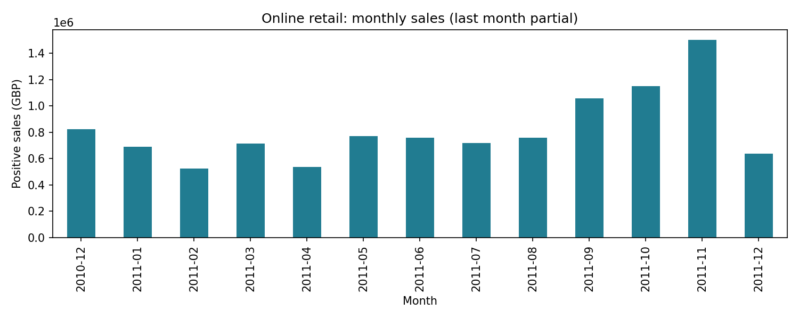
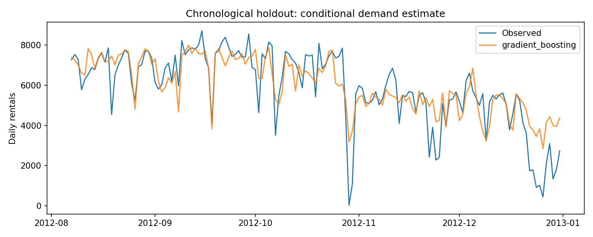
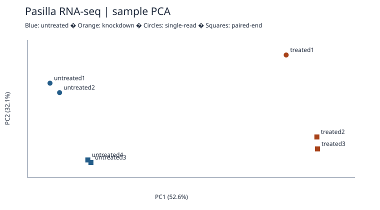

# Hi, I’m Okan 👋

I’m studying Industrial Mathematics at TU Dortmund. My interests are data analysis, machine learning and bioinformatics, with mathematics as the common starting point.

I graduated first in Mathematics at Yeditepe University and am looking for a working student role around Dortmund.

[Portfolio website](https://okankaya07.github.io/) · [LinkedIn](https://www.linkedin.com/in/okan-kaya-708a2a279) · [Email](mailto:okankaya0207@gmail.com)

## Start here

These three projects offer different ways into my work. Each page includes the data, code, output and an explanation of the result.

<table>
<tr>
<td width="33%" valign="top"><a href="projects/01-retail-analytics/README.md"><strong>Retail sales · Python &amp; SQL</strong></a><br><a href="projects/01-retail-analytics/README.md"></a><br>From 541,909 invoice lines to monthly sales, order counts and average order value.</td>
<td width="33%" valign="top"><a href="projects/03-bike-demand/README.md"><strong>Bike demand · Machine learning</strong></a><br><a href="projects/03-bike-demand/README.md"></a><br>Three models compared using chronological validation. Holdout MAE of 725 rentals for the selected model.</td>
<td width="33%" valign="top"><a href="projects/07-pasilla-rnaseq/README.md"><strong>Pasilla · RNA-seq exploration</strong></a><br><a href="projects/07-pasilla-rnaseq/README.md"></a><br>A sample comparison that considers both knockdown status and sequencing layout.</td>
</tr>
</table>

## Projects

| Project | Tools | What to look for | Open |
|---|---|---|---|
| [Retail sales](projects/01-retail-analytics/README.md) | Python · pandas · SQLite · Matplotlib | Monthly positive sales and order counts | [Code](sql/retail.sql) · [Output](reports/monthly_sales.csv) |
| [Customer segmentation](projects/02-customer-segmentation/README.md) | Python · pandas · NumPy · scikit-learn | Compare recency, frequency and spend | [Code](run.py) · [Output](reports/segment_profiles.csv) |
| [Bike rental demand](projects/03-bike-demand/README.md) | Python · pandas · scikit-learn · Matplotlib | Evaluate demand estimates on later dates | [Code](run.py) · [Output](reports/bike_metrics.csv) |
| [Excel operations](projects/04-excel-bike-operations/README.md) | Excel · SUMIFS · COUNTIFS · JavaScript | Filter demand by year and day type; inspect formulas and reconciled totals | [Code](projects/04-excel-bike-operations/build_workbook.mjs) · [Output](projects/04-excel-bike-operations/bike_operations.xlsx) |
| [Air-quality pipeline](projects/05-python-air-quality/README.md) | Python standard library · SQLite · unittest | Keep missing readings visible in daily summaries | [Code](projects/05-python-air-quality/air_quality.py) · [Output](projects/05-python-air-quality/reports/daily_summary.csv) |
| [Leukemia expression](projects/06-r-bioinformatics/README.md) | Base R · Welch tests · PCA | Explore variation across 38 tumor samples | [Code](projects/06-r-bioinformatics/analyze.R) · [Output](projects/06-r-bioinformatics/reports/summary.csv) |
| [Pasilla RNA-seq](projects/07-pasilla-rnaseq/README.md) | Python · pandas · NumPy | Compare condition and read-layout patterns | [Code](projects/07-pasilla-rnaseq/analyze.py) · [Output](projects/07-pasilla-rnaseq/reports/samples.csv) |

## About my studies

My current courses cover deep learning, optimization, simulation techniques and numerical methods. My mathematics degree included a Python project on fractals. I also completed preparatory biotechnology coursework, which connects to the expression-data projects here.

## Run locally

Python 3.12 recommended. From the repository root:

```bash
python -m venv .venv
# Windows: .venv\Scripts\activate
# macOS/Linux: source .venv/bin/activate
python -m pip install -r requirements.txt
python run.py
python -m unittest discover -s tests -v
python -m unittest discover -s projects/05-python-air-quality -v
```

`run.py` reproduces projects 1–3 and downloads their original UCI archives. `python run.py --download-only` downloads without analyzing. Projects 4–7 have their own instructions linked above. Raw archives, local caches, and SQLite databases are ignored by Git. Reports, charts, the Excel workbook, and source hashes are versioned. Unit tests use tiny constructed edge cases; all reported analytical results use real source data. Do not load pickle caches from third parties; delete your local `data/cache/` to rebuild.

## Evidence and reproducibility

- [Source provenance](data/provenance.json): original URLs and archive hashes.
- [Generated findings](reports/FINDINGS.md): measured outputs from a full local run.
- [SQL](sql/retail.sql): monthly revenue, average order value, and month-over-month change.
- [Pipeline](run.py): download, cleaning, analysis, training, and export.
- [Tests](tests/test_outputs.py): reconciliation, leakage checks, split integrity, and output validation.

The small dataset checks and fixed random seeds make unexpected changes visible. Exact numeric results can vary slightly across numerical libraries and hardware. Dependency versions are pinned for the primary libraries; `environment.txt` records the actual local execution versions.

## Data sources and attribution

1. Chen, D. (2015). **Online Retail**. UCI Machine Learning Repository. [Dataset](https://archive.ics.uci.edu/dataset/352/online+retail), [DOI: 10.24432/C5BW33](https://doi.org/10.24432/C5BW33). Real UK retail transactions, December 2010–December 2011.
2. Fanaee-T, H. (2013). **Bike Sharing**. UCI Machine Learning Repository. [Dataset](https://archive.ics.uci.edu/dataset/275/bike+sharing+dataset), [DOI: 10.24432/C5W894](https://doi.org/10.24432/C5W894). Capital Bikeshare observations, 2011–2012.

These two datasets are distributed by UCI under CC BY 4.0. Derived data and charts retain that attribution. The air-quality and Golub projects document their own source terms in their READMEs: the air-quality source explicitly excludes commercial use, and the Bioconductor package is LGPL. Original project code is MIT licensed; third-party data are not relicensed as MIT. These historical datasets demonstrate methods and do not describe current conditions.

## Portfolio notes

These projects were developed with AI assistance in coding and documentation. The linked scripts, datasets and output files document how the results were produced.

Türkçe: Bu repo gerçek verilerle hazırlanmış yedi proje içerir. Excel, Python, SQL, makine öğrenmesi ve R biyoinformatik çalışmalarında yöntemler, sonuçlar ve sınırlamalar İngilizce açıklanmıştır.
