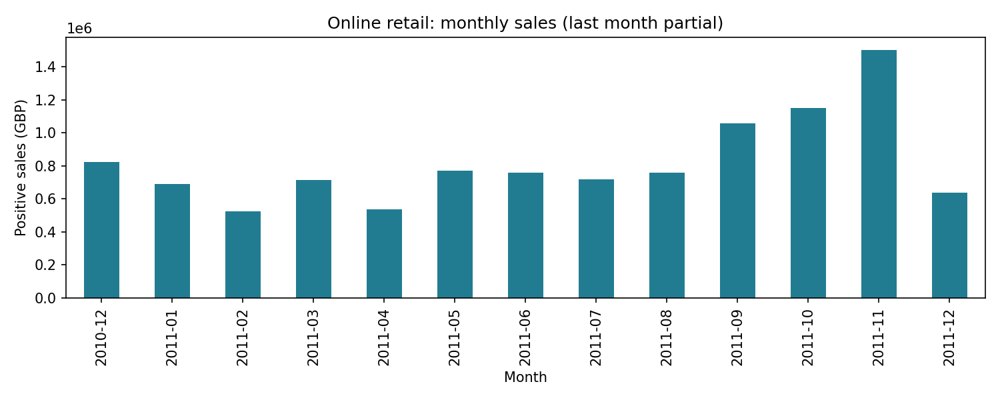
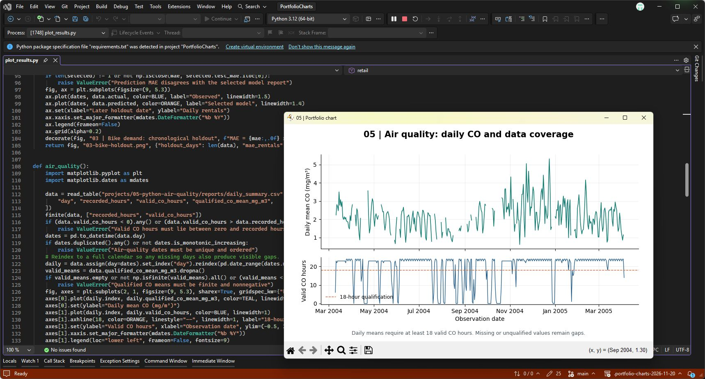
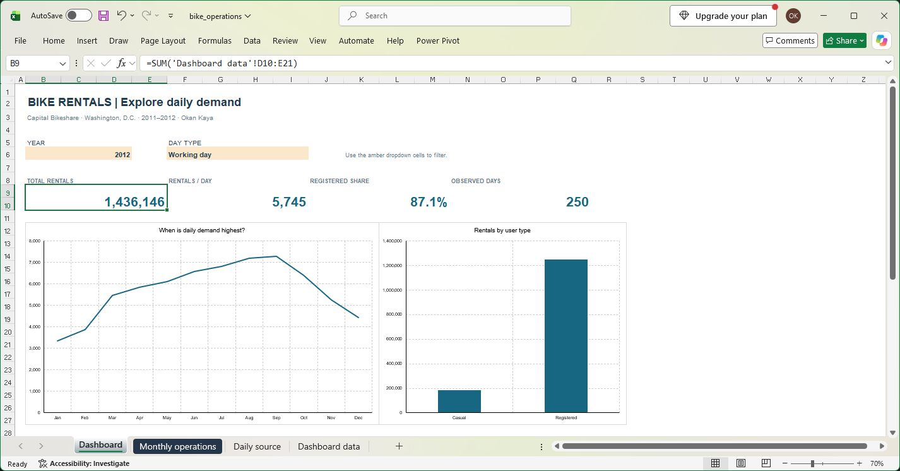

# Hi, I’m Okan 👋

I’m studying Industrial Mathematics at TU Dortmund. My interests are data analysis, machine learning and bioinformatics, with mathematics as the common starting point.

I graduated first in Mathematics at Yeditepe University and am looking for a working student role around Dortmund.

[Portfolio website](https://okankaya07.github.io/) · [LinkedIn](https://www.linkedin.com/in/okan-kaya-708a2a279) · [Email](mailto:okankaya0207@gmail.com)

## Start here

Start with my SQL analysis and Python ETL pipeline, then explore the Excel dashboard. Each project links to the data, code and saved results, with an explanation of the choices I made and what the results can tell us.

<table>
<tr>
<td width="33%" valign="top"><a href="projects/01-retail-analytics/README.md"><strong>Retail sales · SQL &amp; Python</strong></a><br><a href="projects/01-retail-analytics/README.md"></a><br>541,909 invoice lines audited; a SQLite CTE and LAG track monthly sales, orders and average order value.<br><a href="sql/retail.sql">SQL query</a> · <a href="reports/monthly_sales.csv">Results</a></td>
<td width="33%" valign="top"><a href="projects/05-python-air-quality/README.md"><strong>Air quality · Python ETL &amp; SQLite</strong></a><br><a href="projects/05-python-air-quality/README.md"></a><br>9,357 sensor observations with explicit missing-value handling, duplicate rejection and five pipeline tests.<br><a href="projects/05-python-air-quality/air_quality.py">Pipeline</a> · <a href="projects/05-python-air-quality/test_air_quality.py">Tests</a></td>
<td width="33%" valign="top"><a href="projects/04-excel-bike-operations/README.md"><strong>Bike operations · Excel</strong></a><br><a href="projects/04-excel-bike-operations/README.md"></a><br>731 daily records, year and day-type filters, and formulas checked across all nine selections.<br><a href="projects/04-excel-bike-operations/bike_operations.xlsx">Workbook</a> · <a href="projects/04-excel-bike-operations/verification.json">Checks</a></td>
</tr>
</table>

## Projects

| Project | Tools | What to look for | Open |
|---|---|---|---|
| [Retail sales](projects/01-retail-analytics/README.md) | Python · pandas · SQLite · Matplotlib | Monthly positive sales and order counts | [Code](sql/retail.sql) · [Output](reports/monthly_sales.csv) |
| [Customer segmentation](projects/02-customer-segmentation/README.md) | Python · pandas · NumPy · scikit-learn | Compare recency, frequency and spend | [Code](run.py) · [Output](reports/segment_profiles.csv) |
| [Bike rental demand](projects/03-bike-demand/README.md) | Python · pandas · scikit-learn · Matplotlib | Evaluate demand estimates on later dates | [Code](run.py) · [Output](reports/bike_metrics.csv) |
| [Excel operations](projects/04-excel-bike-operations/README.md) | Excel · SUMIFS · COUNTIFS · JavaScript | Filter demand by year and day type; inspect formulas and reconciled totals | [Code](projects/04-excel-bike-operations/build_workbook.mjs) · [Output](projects/04-excel-bike-operations/bike_operations.xlsx) |
| [Air-quality pipeline](projects/05-python-air-quality/README.md) | Python standard library · SQLite · unittest | Keep missing readings visible in daily summaries | [Code](projects/05-python-air-quality/air_quality.py) · [Output](projects/05-python-air-quality/reports/daily_summary.csv) |
| [Leukemia expression](projects/06-r-bioinformatics/README.md) | Base R · Welch tests · PCA | Explore variation across 38 tumor samples | [Code](projects/06-r-bioinformatics/analyze.R) · [Output](projects/06-r-bioinformatics/reports/summary.csv) |
| [Pasilla RNA-seq](projects/07-pasilla-rnaseq/README.md) | Python · pandas · NumPy | Compare condition and read-layout patterns | [Code](projects/07-pasilla-rnaseq/analyze.py) · [Output](projects/07-pasilla-rnaseq/reports/samples.csv) |
| [Diagnostic risk classification](projects/08-diagnostic-risk-classification/README.md) | Python · pandas · scikit-learn | Leakage-aware classification with a development-set threshold and untouched holdout | [Code](projects/08-diagnostic-risk-classification/analyze.py) · [Output](projects/08-diagnostic-risk-classification/reports/model_metrics.csv) |
| [Bank campaign propensity](projects/09-bank-campaign-propensity/README.md) | Python · pandas · scikit-learn | Rank pre-contact subscription propensity with earlier-to-later validation and a fixed capacity policy | [Code](projects/09-bank-campaign-propensity/analyze.py) · [Output](projects/09-bank-campaign-propensity/reports/model_comparison.csv) |
## About my studies

My current courses cover deep learning, optimization, simulation techniques and numerical methods. During my mathematics degree, I worked on fractals with Python. I also completed preparatory biotechnology coursework, which gives some background for the expression-data projects here.

## Run locally

[Visual Studio walkthrough](docs/visual-studio/README.md)

Python 3.12 recommended. From the repository root:

```bash
python -m venv .venv
# Windows: .venv\Scripts\activate
# macOS/Linux: source .venv/bin/activate
python -m pip install -r requirements.txt
python run.py
python -m unittest discover -s tests -v
python -m unittest discover -s projects/05-python-air-quality -v
```

`run.py` downloads the original UCI archives and runs projects 1–3. Use `python run.py --download-only` if you only need the data. Projects 4–9 have their own instructions on the linked pages.

I keep the reports, charts, Excel workbook and source hashes in Git. Raw archives, local caches and SQLite databases are ignored. The tests use small constructed cases to check edge cases; the reported analysis results come from the real source data. Do not load pickle caches from third parties; delete your local `data/cache/` to rebuild.

## Evidence and reproducibility

- [Source provenance](data/provenance.json): original URLs and archive hashes.
- [Generated findings](reports/FINDINGS.md): measured outputs from a full local run.
- [SQL](sql/retail.sql): monthly revenue, average order value, and month-over-month change.
- [Pipeline](run.py): download, cleaning, analysis, training, and export.
- [Tests](tests/test_outputs.py): reconciliation, leakage checks, split integrity, and output validation.
- [Air-quality CI](.github/workflows/air-quality-tests.yml): five standard-library pipeline tests on relevant pushes and pull requests, without downloading source data.

I use checks and fixed random seeds to make changes in the results easier to spot. The main dependencies are pinned, and `environment.txt` records the versions used for the local run. Small numerical differences across library versions or hardware are still possible.

## Data sources and attribution

1. Chen, D. (2015). **Online Retail**. UCI Machine Learning Repository. [Dataset](https://archive.ics.uci.edu/dataset/352/online+retail), [DOI: 10.24432/C5BW33](https://doi.org/10.24432/C5BW33). Real UK retail transactions, December 2010–December 2011.
2. Fanaee-T, H. (2013). **Bike Sharing**. UCI Machine Learning Repository. [Dataset](https://archive.ics.uci.edu/dataset/275/bike+sharing+dataset), [DOI: 10.24432/C5W894](https://doi.org/10.24432/C5W894). Capital Bikeshare observations, 2011–2012.

These two datasets are distributed by UCI under CC BY 4.0. Derived data and charts retain that attribution. The air-quality and Golub projects document their own source terms in their READMEs: the air-quality source explicitly excludes commercial use, and the Bioconductor package is LGPL. Original project code is MIT licensed; third-party data are not relicensed as MIT. These historical datasets demonstrate methods and do not describe current conditions.

## Portfolio notes

The project explanations take presentation inspiration from [Luke Barousse's Python Data Analytics Course](https://github.com/lukebarousse/Python_Data_Analytics_Course/tree/main/3_Project). The data, code and results for this portfolio are linked above.

These projects were developed with AI assistance in coding and documentation. The linked scripts, datasets and output files document how the results were produced.

Türkçe: Bu repo gerçek verilerle hazırlanmış dokuz proje içerir. Excel, Python, SQL, makine öğrenmesi ve R biyoinformatik çalışmalarında ne yaptığımı, sonuçları ve sınırlamaları İngilizce anlattım.
