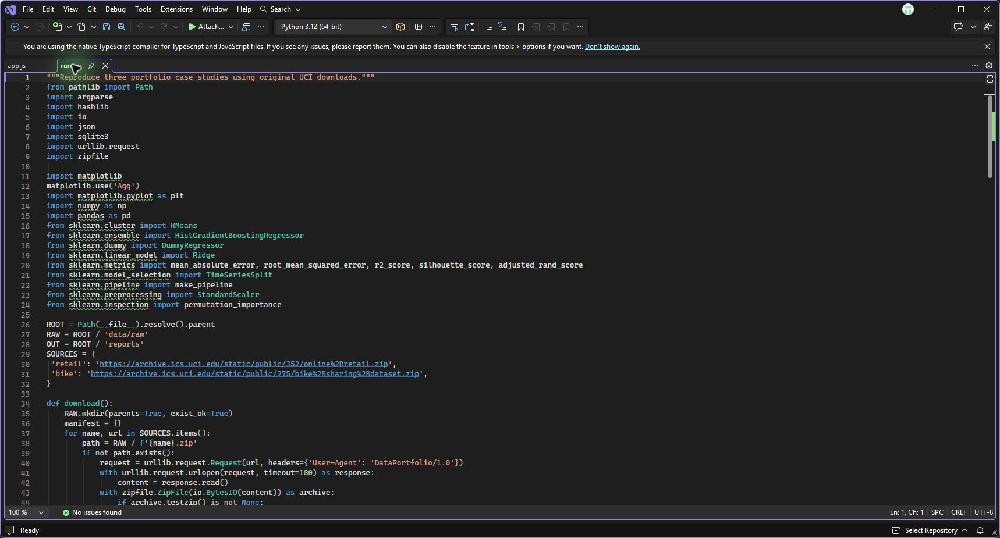
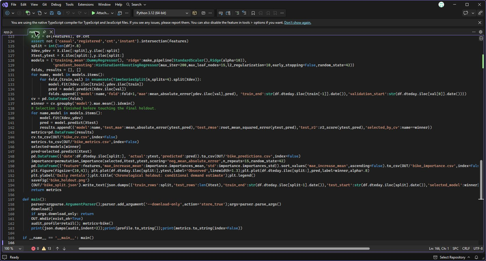

# Visual Studio walkthrough

1. Open `run.py` in Visual Studio. The script defines the original UCI data sources for the retail, customer segmentation and bike demand analyses.

   

2. Go to the end of `run.py`. The bike demand workflow uses chronological validation to select a model, then evaluates it on the held-out dates and writes the results.

   

3. Follow the [local setup instructions](../../README.md#run-locally), run `python run.py` from the repository root and inspect the generated files in [reports](../../reports/). The [project index](../../README.md#projects) links to the individual workflows and outputs.
