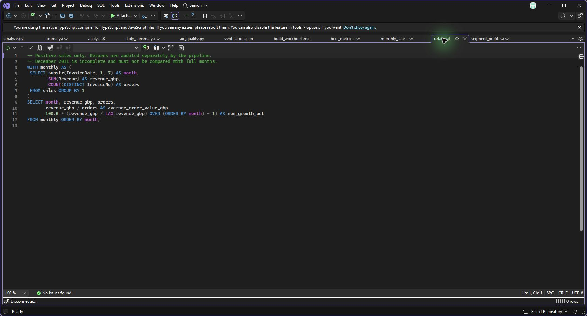
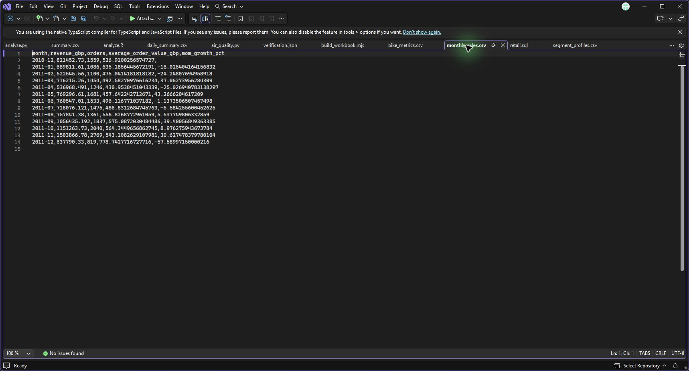
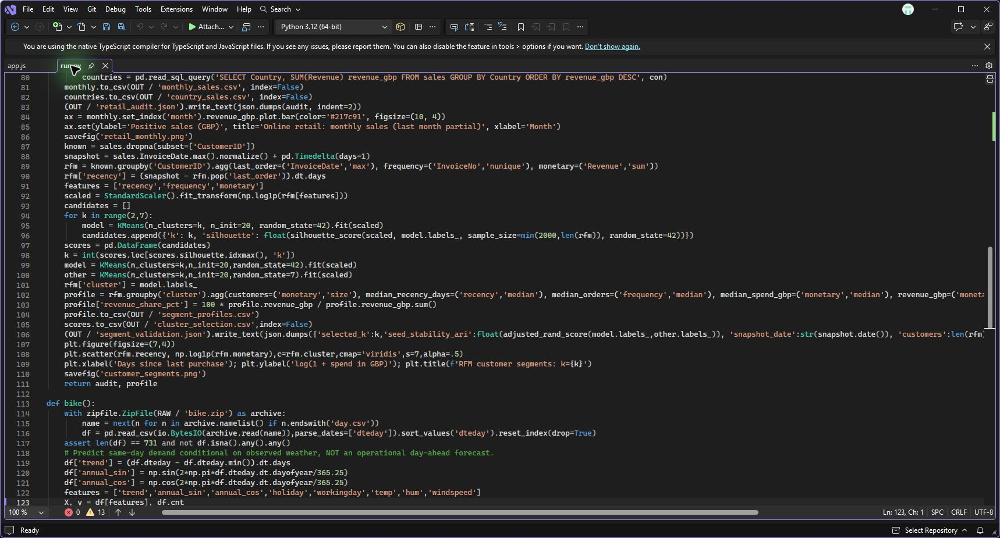
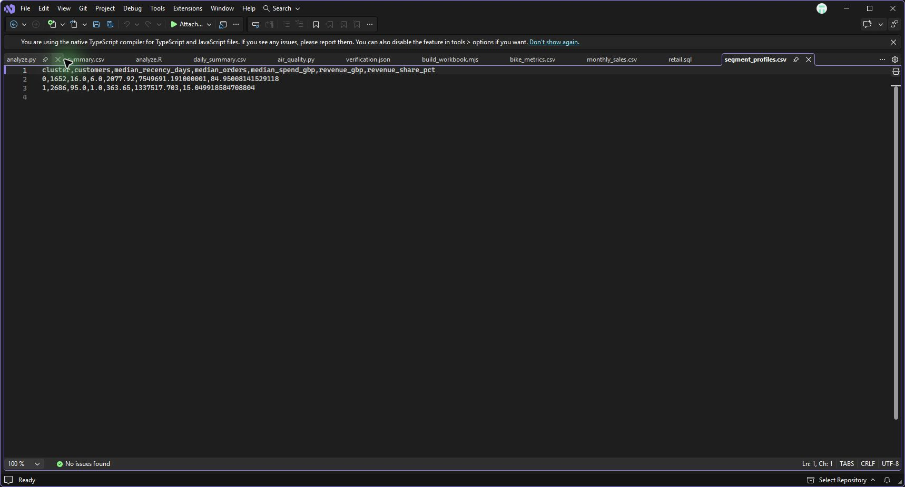
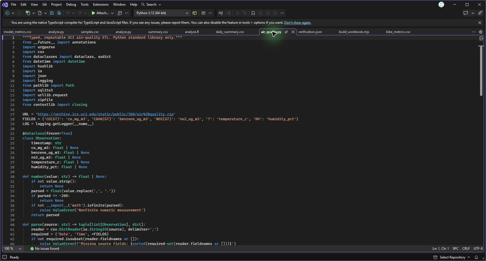
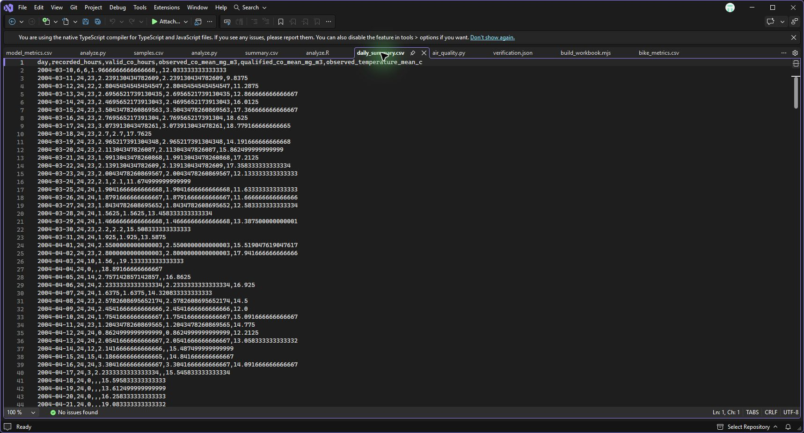
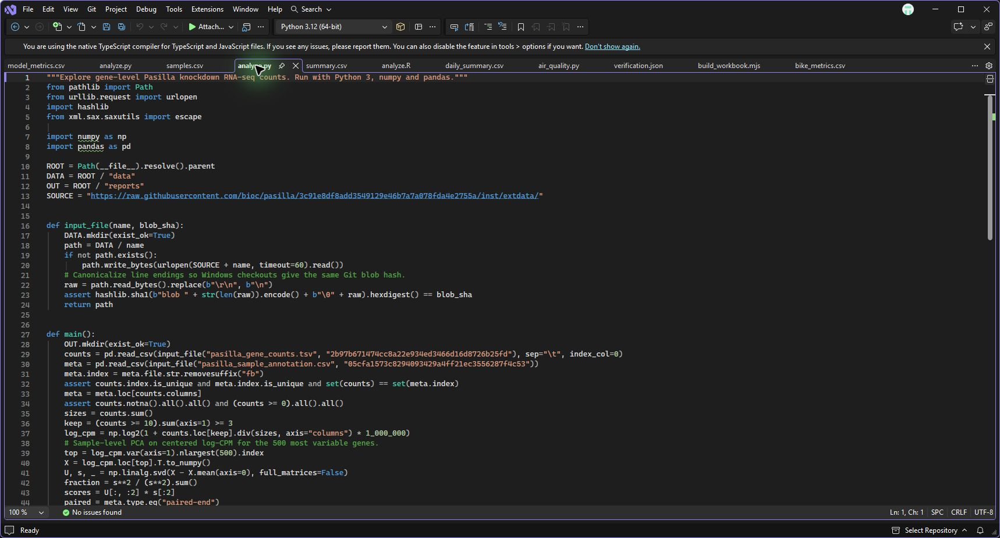
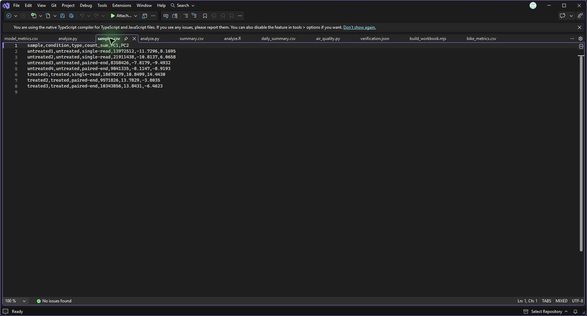
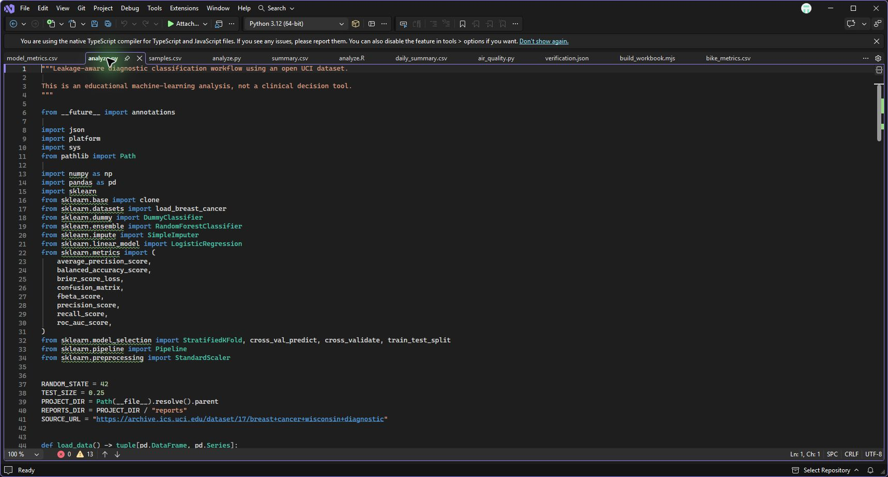
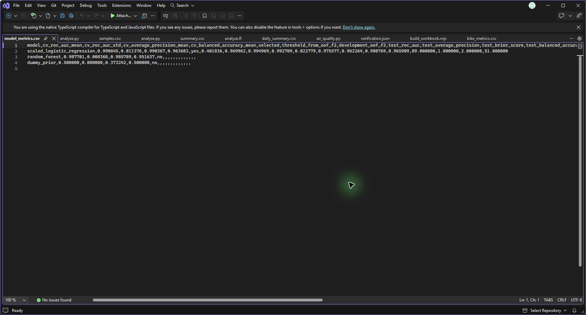

# Projects in Visual Studio

These screenshots show the source files and saved project outputs open in Visual Studio. Each project page links to its reproduction instructions.

- [Retail sales](#01-retail-sales)
- [Customer segmentation](#02-customer-segmentation)
- [Bike rental demand](#03-bike-rental-demand)
- [Excel bike operations](#04-excel-bike-operations)
- [Air quality pipeline](#05-air-quality-pipeline)
- [Leukemia expression analysis](#06-leukemia-expression-analysis)
- [Pasilla RNA-seq](#07-pasilla-rna-seq)
- [Diagnostic risk classification](#08-diagnostic-risk-classification)

## 01 Retail sales

[Project instructions](../../projects/01-retail-analytics/README.md)

1. Open [retail.sql](../../sql/retail.sql) to inspect the code.

   

2. Open [monthly_sales.csv](../../reports/monthly_sales.csv) to inspect the saved output.

   

## 02 Customer segmentation

[Project instructions](../../projects/02-customer-segmentation/README.md)

1. Open [run.py](../../run.py) to inspect the code.

   

2. Open [segment_profiles.csv](../../reports/segment_profiles.csv) to inspect the saved output.

   

## 03 Bike rental demand

[Project instructions](../../projects/03-bike-demand/README.md)

1. Open [run.py](../../run.py) to inspect the code.

   

2. Open [bike_metrics.csv](../../reports/bike_metrics.csv) to inspect the saved output.

   

## 04 Excel bike operations

[Project instructions](../../projects/04-excel-bike-operations/README.md)

1. Open [build_workbook.mjs](../../projects/04-excel-bike-operations/build_workbook.mjs) to inspect the code.

   

2. Open [verification.json](../../projects/04-excel-bike-operations/verification.json) to inspect the saved output.

   

   The JSON shows the workbook validation results. Open the [generated workbook](../../projects/04-excel-bike-operations/bike_operations.xlsx) in Excel to use the dashboard.

## 05 Air quality pipeline

[Project instructions](../../projects/05-python-air-quality/README.md)

1. Open [air_quality.py](../../projects/05-python-air-quality/air_quality.py) to inspect the code.

   

2. Open [daily_summary.csv](../../projects/05-python-air-quality/reports/daily_summary.csv) to inspect the saved output.

   

## 06 Leukemia expression analysis

[Project instructions](../../projects/06-r-bioinformatics/README.md)

1. Open [analyze.R](../../projects/06-r-bioinformatics/analyze.R) to inspect the code.

   

2. Open [summary.csv](../../projects/06-r-bioinformatics/reports/summary.csv) to inspect the saved output.

   

## 07 Pasilla RNA-seq

[Project instructions](../../projects/07-pasilla-rnaseq/README.md)

1. Open [analyze.py](../../projects/07-pasilla-rnaseq/analyze.py) to inspect the code.

   

2. Open [samples.csv](../../projects/07-pasilla-rnaseq/reports/samples.csv) to inspect the saved output.

   

## 08 Diagnostic risk classification

[Project instructions](../../projects/08-diagnostic-risk-classification/README.md)

1. Open [analyze.py](../../projects/08-diagnostic-risk-classification/analyze.py) to inspect the code.

   

2. Open [model_metrics.csv](../../projects/08-diagnostic-risk-classification/reports/model_metrics.csv) to inspect the saved output.

   
