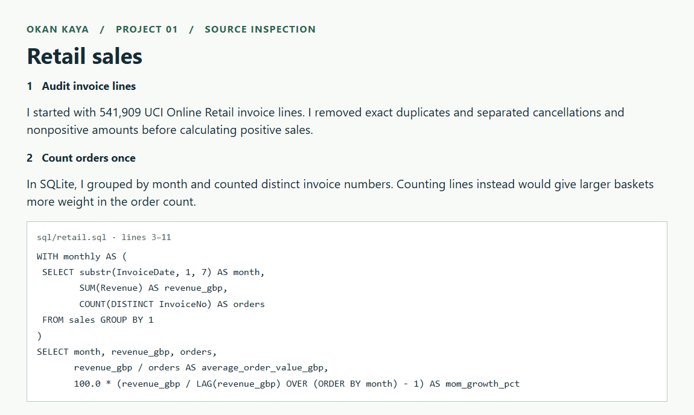
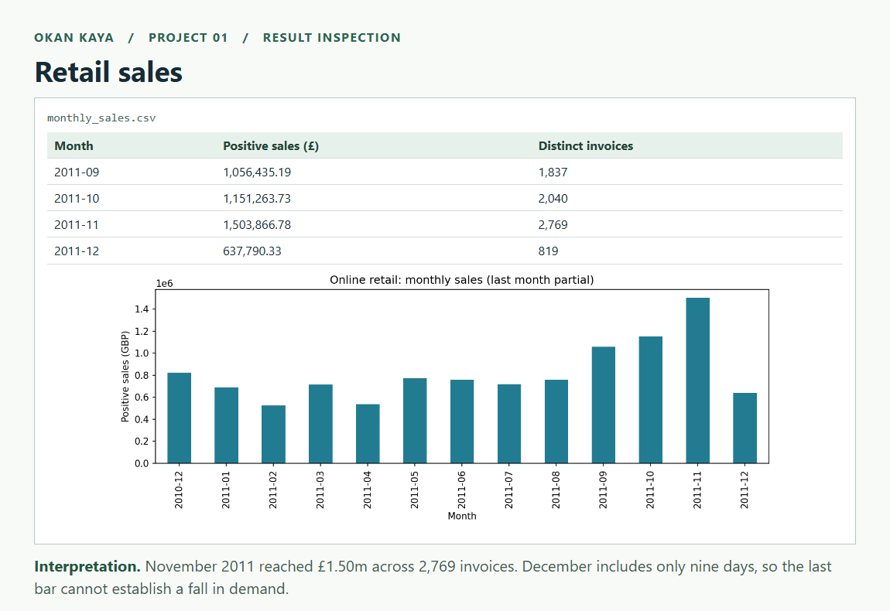
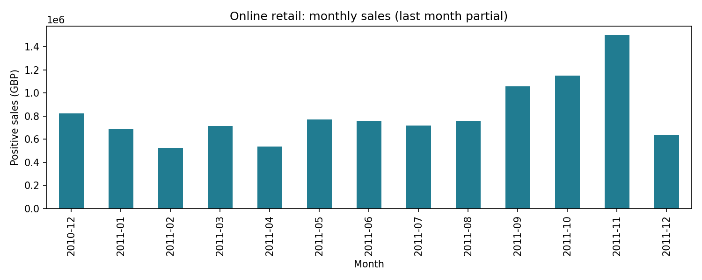

# Retail sales with Python and SQL

[← All projects](../../README.md#projects) · [Source code](../../sql/retail.sql) · [Results](../../reports/monthly_sales.csv)

**Tools** · Python · pandas · SQLite · Matplotlib

This project follows a retail dataset from invoice lines to monthly sales totals. The main question is how much of a change comes from order volume and how much comes from average order value.

## Questions I wanted to answer

1. How do monthly positive sales and order counts change?
2. Is a larger sales total associated with more orders, a higher average order value, or both?
3. Which cleaning decisions affect the meaning of those totals?

## Tools and why I used them

| Tool | Role in this project |
|---|---|
| pandas | Read the workbook, audit duplicates and missing IDs, filter invoice lines and calculate line values |
| SQLite / SQL | Aggregate distinct orders and monthly sales; use `LAG` for the previous month's comparison |
| Matplotlib | Plot the monthly totals so coverage and changes are visible |

## Step-by-step walkthrough

1. **Audit invoice lines.** I started with 541,909 UCI Online Retail invoice lines. I removed exact duplicates and separated cancellations and nonpositive amounts before calculating positive sales.
2. **Count orders once.** In SQLite, I grouped by month and counted distinct invoice numbers. Counting lines instead would give larger baskets more weight in the order count. [Open the implementation](../../sql/retail.sql#L3-L11).

```sql
WITH monthly AS (
 SELECT substr(InvoiceDate, 1, 7) AS month,
        SUM(Revenue) AS revenue_gbp,
        COUNT(DISTINCT InvoiceNo) AS orders
 FROM sales GROUP BY 1
)
SELECT month, revenue_gbp, orders,
       revenue_gbp / orders AS average_order_value_gbp,
       100.0 * (revenue_gbp / LAG(revenue_gbp) OVER (ORDER BY month) - 1) AS mom_growth_pct
```

<details>
<summary>Open the annotated code screenshot</summary>



</details>

3. **Inspect the output.** Open [monthly_sales.csv](../../reports/monthly_sales.csv) and the [analysis figure](../../reports/retail_monthly.png). The screenshot puts the saved output beside a short explanation.
4. **Interpret the result.** November 2011 reached £1.50m across 2,769 invoices. December includes only nine days, so the last bar cannot establish a fall in demand.



## Approach

The source workbook has 541,909 transaction lines. The pipeline audits missing customer identifiers, exact duplicates, nonpositive prices, and negative quantities. It removes exact duplicates, separates negative-quantity transactions, and defines positive sales as positive quantity and price on non-cancellation invoices. Missing customer IDs remain in sales totals.

SQLite queries aggregate invoices into monthly sales, orders, average order value, and month-over-month growth using a CTE and `LAG`. Country-level results reveal geographic concentration. Values are nominal GBP. Positive sales are not profit or accounting net revenue: costs, taxes, matched returns, and adjustments are unavailable. Dropping exact duplicate rows is an explicit assumption; identical legitimate lines could exist.



## Deliverables

- [SQL query](../../sql/retail.sql)
- [Monthly KPIs](../../reports/monthly_sales.csv)
- [Country sales](../../reports/country_sales.csv)
- [Cleaning audit](../../reports/retail_audit.json)
- [Measured findings](../../reports/FINDINGS.md)

## Interpretation and limits

The first and last months also have incomplete customer observation windows. Negative quantities are audited separately and cannot automatically be interpreted as matched refunds. Costs and matched returns would be needed before using these totals to recommend budget changes.

## What I learned

- **Define the metric before plotting it.** The filtering rule produces positive sales. It does not produce net revenue or profit, because returns are not matched and costs are unavailable.
- **The unit of analysis changes the answer.** A row is an invoice line, not an order. Counting distinct invoice numbers prevents a large basket from becoming several orders.
- **Missing data needs a purpose-specific decision.** A missing customer ID does not invalidate a sales amount. I retain those rows for sales reporting but exclude them when building customer profiles.
- **A chart needs its observation window.** December's short coverage makes a full-month comparison misleading. A small final bar is not enough to conclude that demand collapsed.

## Challenges and decisions

The main difficulty is deciding which records belong in the analysis. The audit records **5,268 exact duplicates** and **135,080 rows without customer IDs** in the original file. These counts describe different conditions and should not be added as though they were disjoint exclusions.

This is the positive-sales filter used in the pipeline after duplicate removal:

```python
sales = frame[
    (frame.Quantity > 0)
    & (frame.UnitPrice > 0)
    & ~frame.InvoiceNo.str.upper().str.startswith('C')
].copy()
```

The result contains **524,878 lines**. I keep the [audit](../../reports/retail_audit.json) alongside the output so the filtering decision is visible, rather than presenting the chart as if it came directly from untouched data.

## What I would improve next

I would add an explicit coverage column to the monthly report and inspect non-product stock codes. Matching returns to original invoices would be a separate next step before describing the result as net sales.

[See the code and output in Visual Studio](../../docs/visual-studio/README.md#01-retail-sales).
