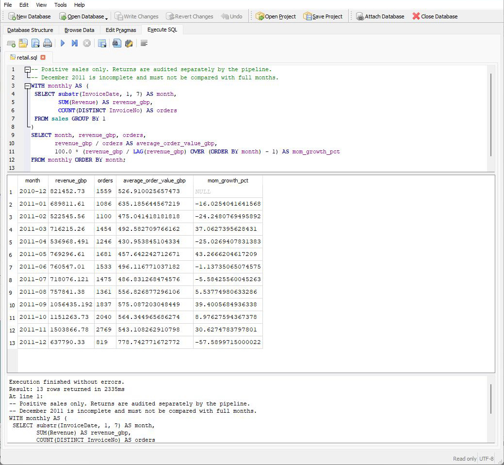
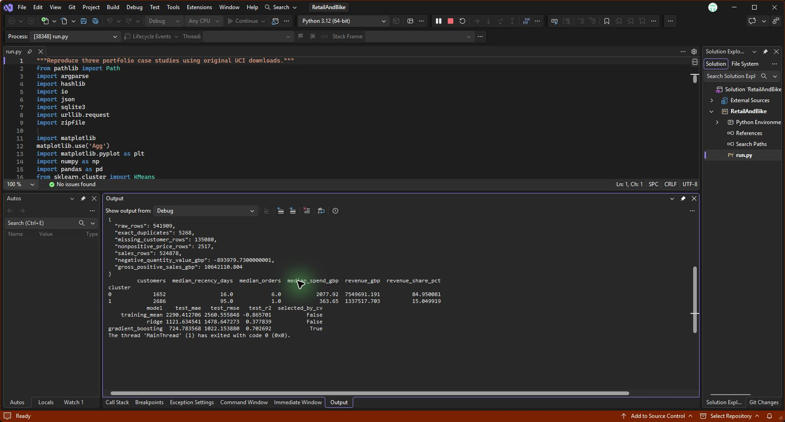
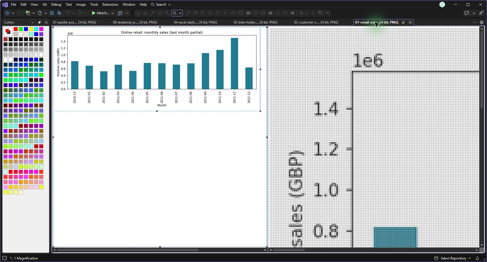
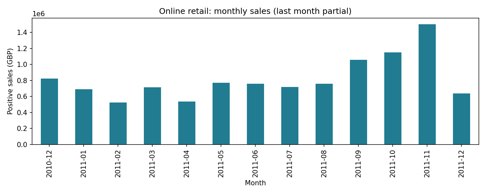

# Retail sales with Python and SQL

[← All projects](../../README.md#projects) · [Source code](../../sql/retail.sql) · [Results](../../reports/monthly_sales.csv)

**Tools** · Python · pandas · SQLite · Matplotlib

November 2011 had £1.50m in positive sales across 2,769 invoices. I used monthly sales, distinct order counts and average order value to check whether changes came from more orders or higher spending per order. December contains only nine days, so its smaller total cannot establish a fall in demand.

## What counts as a sale

The UCI Online Retail workbook contains 541,909 invoice lines. I used pandas to audit missing customer IDs, exact duplicates, nonpositive prices and negative quantities before calculating line values. The audit found **5,268 exact duplicates** and **135,080 rows without customer IDs**. These conditions can overlap, so the counts are not separate exclusions to add together.

After removing exact duplicates, I kept positive quantities and prices on non-cancellation invoices:

```python
sales = frame[
    (frame.Quantity > 0)
    & (frame.UnitPrice > 0)
    & ~frame.InvoiceNo.str.upper().str.startswith('C')
].copy()
```

That leaves **524,878 positive-sales lines**. Missing customer IDs stay in these totals but are excluded from customer profiles. Negative-quantity transactions are audited separately; they cannot automatically be treated as matched refunds. Removing exact duplicates is also an assumption, since identical legitimate lines could exist. The [cleaning audit](../../reports/retail_audit.json) records these choices.

I used SQLite to calculate monthly sales, distinct invoices, average order value and month-over-month growth with a CTE and `LAG`. The [query](../../sql/retail.sql#L3-L11) counts each invoice once, since counting lines as orders would give larger baskets more weight. Country-level totals show geographic concentration. All values are nominal GBP.

## Run the analysis and SQL query

1. Follow the [Python setup](../../README.md#run-locally), then run `python run.py` from the repository root in the Visual Studio terminal. This creates `data/retail.sqlite` and loads the cleaned lines into the `sales` table.
2. In DB Browser for SQLite, open `data/retail.sqlite`, select **Execute SQL**, open [retail.sql](../../sql/retail.sql), and run it. The grid has 13 monthly rows. The same output is saved in [monthly_sales.csv](../../reports/monthly_sales.csv).

```sql
-- Positive sales only. Returns are audited separately by the pipeline.
-- December 2011 is incomplete and must not be compared with full months.
WITH monthly AS (
 SELECT substr(InvoiceDate, 1, 7) AS month,
        SUM(Revenue) AS revenue_gbp,
        COUNT(DISTINCT InvoiceNo) AS orders
 FROM sales GROUP BY 1
)
SELECT month, revenue_gbp, orders,
       revenue_gbp / orders AS average_order_value_gbp,
       100.0 * (revenue_gbp / LAG(revenue_gbp) OVER (ORDER BY month) - 1) AS mom_growth_pct
FROM monthly ORDER BY month;
```



The Visual Studio Python debugger output shows the audit, including the 541,909 input rows and 524,878 positive-sales rows.



I used Matplotlib to plot the monthly totals. The short final month is visible in the chart.

[](../../reports/retail_monthly.png)



## Reports and limits

- [SQL query](../../sql/retail.sql)
- [Monthly KPIs](../../reports/monthly_sales.csv)
- [Country sales](../../reports/country_sales.csv)
- [Cleaning audit](../../reports/retail_audit.json)
- [Measured findings](../../reports/FINDINGS.md)

These are positive sales, not profit or accounting net revenue. Costs, taxes, matched returns and adjustments are unavailable, so the totals are not enough to recommend budget changes. The first and last months also have incomplete customer observation windows.

I would add a coverage column to the monthly report and inspect non-product stock codes next. Matching returns to original invoices would be needed before describing the result as net sales.
