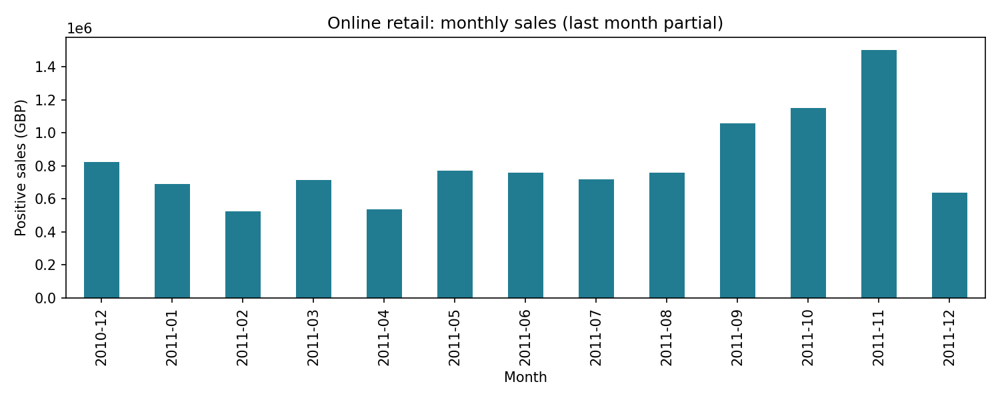

# 01 · Retail sales analytics

**Decision:** Where should a retailer focus performance monitoring and commercial investigation?

## Approach

The source workbook has 541,909 transaction lines. The pipeline audits missing customer identifiers, exact duplicates, nonpositive prices, and negative quantities. It removes exact duplicates, separates negative-quantity transactions, and defines positive sales as positive quantity and price on non-cancellation invoices. Missing customer IDs remain in sales totals.

SQLite queries aggregate invoices into monthly sales, orders, average order value, and month-over-month growth using a CTE and `LAG`. Country-level results reveal geographic concentration. Values are nominal GBP. Positive sales are not profit or accounting net revenue: costs, taxes, matched returns, and adjustments are unavailable. Dropping exact duplicate rows is an explicit assumption; identical legitimate lines could exist.

## Deliverables

- [SQL query](../../sql/retail.sql)
- [Monthly KPIs](../../reports/monthly_sales.csv)
- [Country sales](../../reports/country_sales.csv)
- [Cleaning audit](../../reports/retail_audit.json)
- [Measured findings](../../reports/FINDINGS.md)

## Interpretation and next steps

December 2011 ends on the ninth and must not be treated as a full-month decline. The first and last months also have incomplete customer observation windows. Negative quantities are audited separately and cannot automatically be interpreted as matched refunds. Investigate large orders and non-product stock codes before building a production revenue dashboard. Add product classifications, return matching, and margin data before recommending budget changes.

**Interview discussion:** Why count distinct invoices rather than rows? Why retain anonymous orders in aggregate KPIs? How would you handle a partial month in an executive report?
