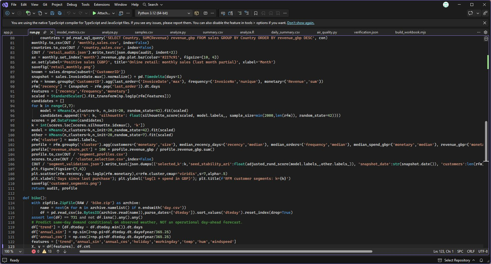
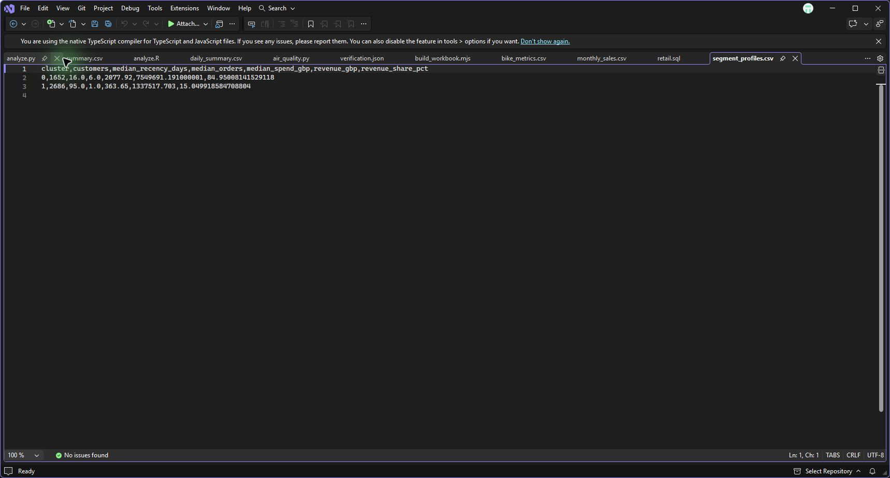
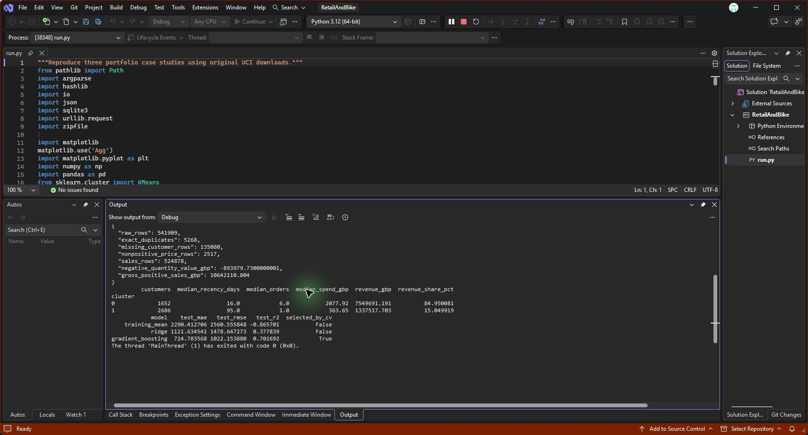
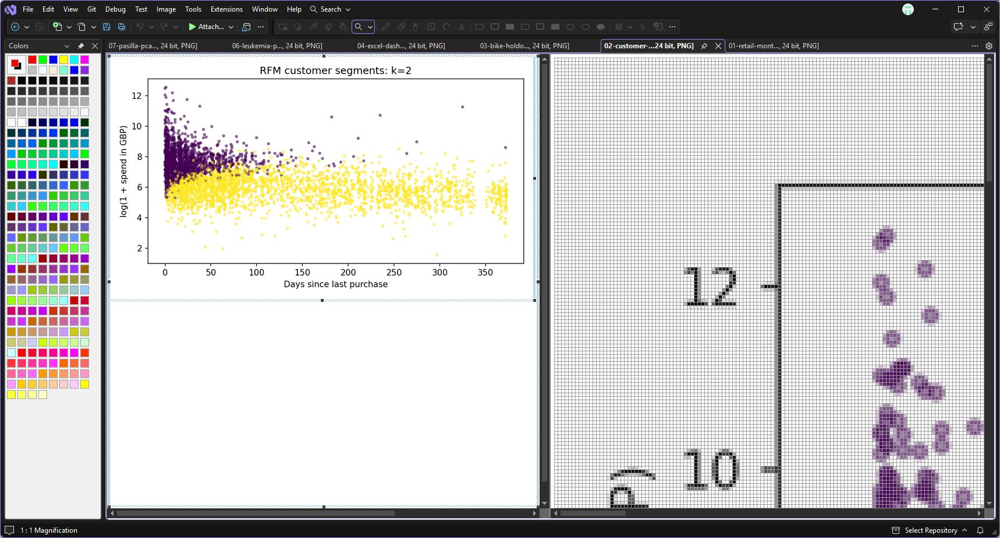

# Customer groups from purchase history

[← All projects](../../README.md#projects) · [Source code](../../run.py) · [Results](../../reports/segment_profiles.csv)

**Tools** · Python · pandas · NumPy · scikit-learn · Matplotlib

This analysis groups 4,338 customers by how recently they ordered, how often they ordered and how much they spent. The useful part is comparing the resulting profiles and deciding what would need testing before acting on them.

## Questions I wanted to answer

1. Do customers form distinct groups by recency, order frequency and spending?
2. How much of identified-customer sales comes from each group?
3. Are the groups similar when the clustering is initialized with a different seed?

## Tools and why I used them

| Tool | Role in this project |
|---|---|
| pandas | Build one RFM record per identified customer and summarize cluster profiles |
| NumPy | Apply `log1p` to reduce the influence of large values |
| scikit-learn | Standardize features, fit K-means and compare silhouette scores and seed stability |
| Matplotlib | Plot recency against log spending, colored by cluster |

## Code and results in Visual Studio

1. **Build a customer-level table.** I kept identified customers and used pandas to calculate days since the last purchase, distinct orders and total positive spend. Anonymous sales cannot be attributed to a customer.
2. **Make the three measures comparable.** I applied log1p and StandardScaler before scikit-learn K-means. Otherwise large monetary values could dominate the distance calculation. [Open the implementation](../../run.py#L92-L98).

```python
scaled = StandardScaler().fit_transform(np.log1p(rfm[features]))
candidates = []
for k in range(2,7):
    model = KMeans(n_clusters=k, n_init=20, random_state=42).fit(scaled)
    candidates.append({'k': k, 'silhouette': float(silhouette_score(scaled, model.labels_, sample_size=min(2000,len(rfm)), random_state=42))})
scores = pd.DataFrame(candidates)
k = int(scores.loc[scores.silhouette.idxmax(), 'k'])
```



3. **Run the analysis.** Open the repository folder in Visual Studio, follow the [Python setup](../../README.md#run-locally), then run `python run.py` from the repository root in the Visual Studio terminal.
4. **Inspect the output.** Open [segment_profiles.csv](../../reports/segment_profiles.csv) in Visual Studio. The chart below is generated by the same run.



**Visual Studio Output.** The shared `run.py` script printed the two customer groups, with 1,652 and 2,686 customers.



[](../../reports/customer_segments.png)


5. **Interpret the result.** The 1,652-customer group had a median of six orders and accounted for 84.95% of identified-customer sales. The horizontal and vertical axes show recency and spend. Frequency also informed clustering.

## Approach

Known customers from the cleaned positive-sales table are aggregated into recency (days from the analysis snapshot), frequency (distinct invoices), and monetary value (GBP). Anonymous orders cannot be assigned to a customer and are excluded here. The snapshot is one day after the final observed sales date, making the analysis reproducible.

`log1p` reduces heavy-tail effects, then `StandardScaler` puts the three dimensions on comparable scales. K-means candidates k=2…6 use 20 initializations each. The selected k maximizes silhouette on a seeded sample of up to 2,000 customers. Adjusted Rand index compares the final clustering with another random seed. This tests initialization stability, not temporal stability or campaign effectiveness.

## Deliverables

- [Cluster selection](../../reports/cluster_selection.csv)
- [Segment profiles](../../reports/segment_profiles.csv)
- [Validation](../../reports/segment_validation.json)
- [Measured findings](../../reports/FINDINGS.md)

Segment IDs are arbitrary. Interpret them through median recency, order frequency, spending, and revenue share. The scatterplot is a two-dimensional projection; clustering also uses frequency.

## Business use and limitations

Test retention messaging for high-value customers, onboarding for recent low-frequency buyers, and win-back messaging for inactive customers only after inspecting the profiles. Use randomized experiments to measure incremental value. Historical spend is not lifetime value, and low recency alone does not prove churn. Results depend on a limited historical window, outliers, wholesale customers, and exclusion of returns. Compare alternative scaling, return-adjusted values, and month-to-month stability before deployment.

## What I learned

- **Preprocessing is part of the clustering model.** Recency is measured in days, frequency in orders and monetary value in GBP. Standardizing after `log1p` changes the distances on which K-means depends.
- **Cluster numbers have no business meaning by themselves.** I need the profile table to interpret a label. The selected two-group solution separates a group with a median of six orders from one with a median of one order.
- **A good geometric score is not a business outcome.** Silhouette helps compare candidate partitions, but it does not show that targeting a group will increase sales.
- **Stability has more than one meaning.** The adjusted Rand index of **0.998** shows close agreement between two seeds for this dataset. It says nothing about whether the same customers will stay in the same groups next month.

## Challenges and decisions

Large spend values can dominate raw Euclidean distances. I use the same log transformation and scaling for all three RFM measures, then inspect the profiles in their original units so the output remains interpretable.

The **1,652-customer** group accounts for **84.95%** of identified-customer positive sales. That denominator matters: anonymous transactions are outside this customer analysis, even though they remain in the retail sales project. The other **2,686 customers** account for **15.05%**.

The chart only shows recency and spending. Frequency also influences the clustering, so visual overlap in that two-dimensional view does not necessarily contradict the model.

## What I would improve next

I would repeat the analysis at monthly snapshots and compare group membership over time. Before using the groups for a campaign, I would test whether an intervention produces additional purchases using a randomized holdout.
