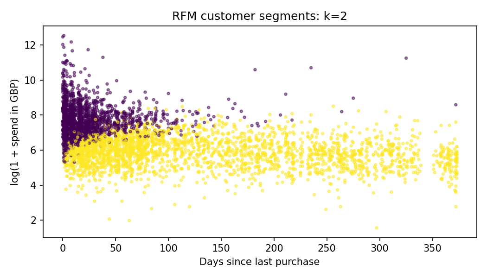

# 02 · RFM customer segmentation

**Decision:** Can purchase behavior support differentiated retention experiments?

## Approach

Known customers from the cleaned positive-sales table are aggregated into recency (days from the analysis snapshot), frequency (distinct invoices), and monetary value (GBP). Anonymous orders cannot be assigned to a customer and are excluded here. The snapshot is one day after the final observed sales date, making the analysis reproducible.

`log1p` reduces heavy-tail effects, then `StandardScaler` puts the three dimensions on comparable scales. K-means candidates k=2…6 use 20 initializations each. The selected k maximizes silhouette on a seeded sample of up to 2,000 customers. Adjusted Rand index compares the final clustering with another random seed. This tests initialization stability, not temporal stability or campaign effectiveness.

## Deliverables

- [Cluster selection](../../reports/cluster_selection.csv)
- [Segment profiles](../../reports/segment_profiles.csv)
- [Validation](../../reports/segment_validation.json)
- [Measured findings](../../reports/FINDINGS.md)

Segment IDs are arbitrary. Interpret them through median recency, order frequency, spending, and revenue share. The scatterplot is a two-dimensional projection; clustering also uses frequency.

## Business use and limitations

Test retention messaging for high-value customers, onboarding for recent low-frequency buyers, and win-back messaging for inactive customers only after inspecting the profiles. Use randomized experiments to measure incremental value. Historical spend is not lifetime value, and low recency alone does not prove churn. Results depend on a limited historical window, outliers, wholesale customers, and exclusion of returns. Compare alternative scaling, return-adjusted values, and month-to-month stability before deployment.

**Interview discussion:** Why transform before scaling? What does silhouette fail to establish? How would you validate whether a segment changes over time?
