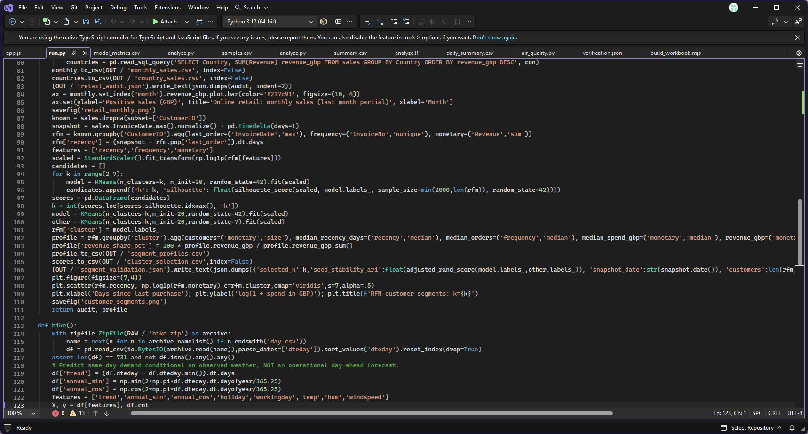
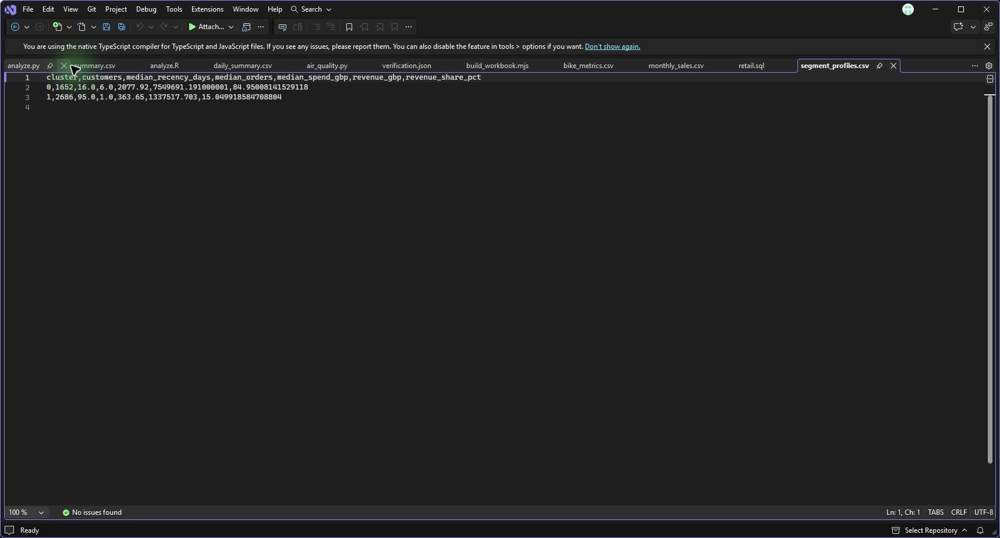
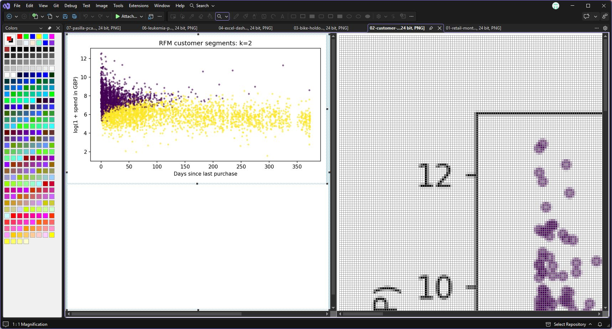
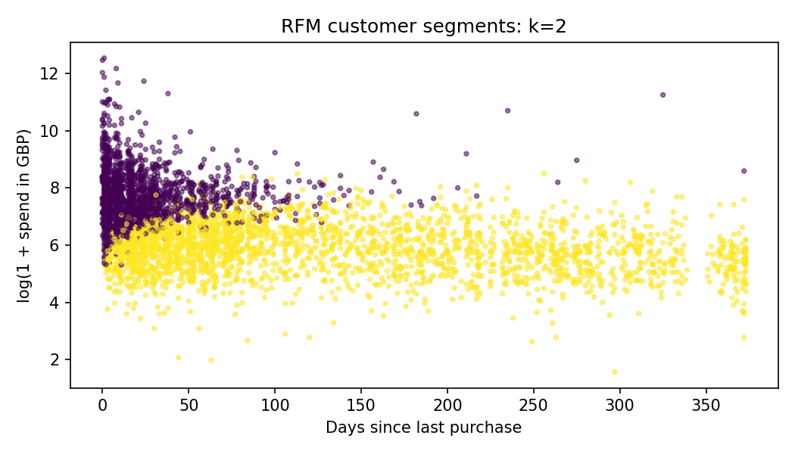
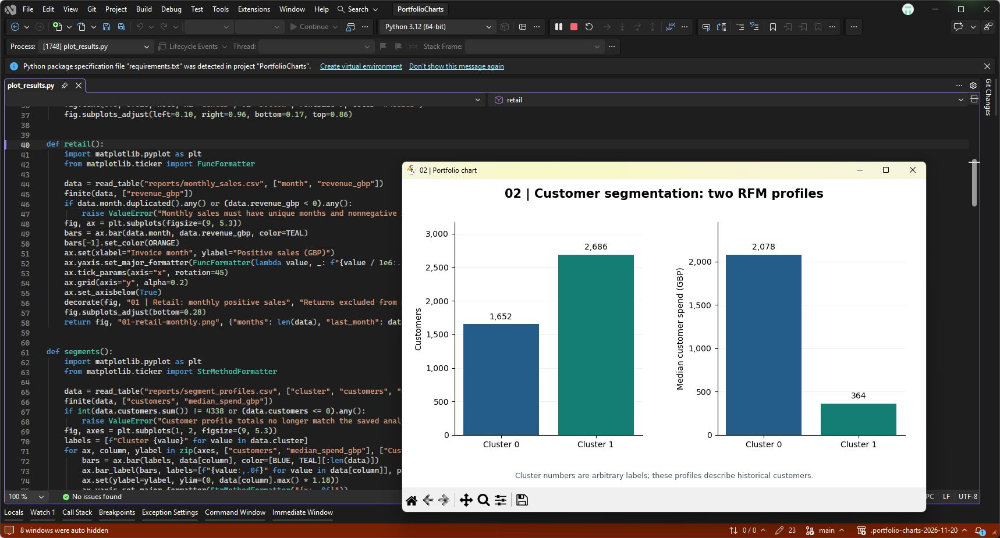
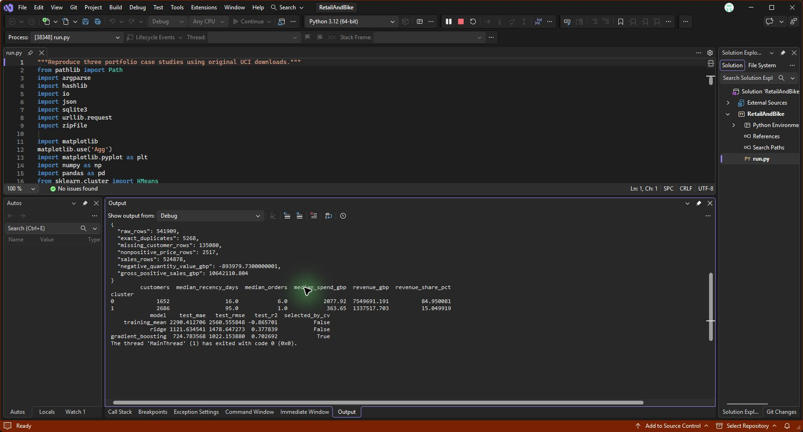

# Customer groups from purchase history

[← All projects](../../README.md#projects) · [Source code](../../run.py) · [Results](../../reports/segment_profiles.csv)

**Tools** · Python · pandas · NumPy · scikit-learn · Matplotlib

Of the 4,338 identified customers, a group of 1,652 accounts for **84.95% of identified-customer positive sales** and has a median of six orders. The other 2,686 customers account for **15.05%** and have a median of one order. I used recency, frequency and spending to build these groups, then compared their profiles and agreement across two random seeds.

## Building the customer table

I kept identified customers from the cleaned positive-sales table and calculated one RFM record per customer:

- **Recency:** days since the last purchase, measured at a snapshot one day after the final observed sales date.
- **Frequency:** distinct invoice count.
- **Monetary value:** total positive spend in GBP.

Anonymous orders remain in the retail sales project but cannot be assigned to a customer here. The sales shares above therefore refer only to identified customers.

Large spending values can dominate raw Euclidean distances. I used NumPy `log1p` and scikit-learn `StandardScaler` on all three features before K-means, then kept the profile summaries in their original units. Each candidate from k=2 through k=6 uses 20 initializations. The highest silhouette score on a seeded sample of up to 2,000 customers selects k. [Open the implementation](../../run.py#L92-L98).

```python
scaled = StandardScaler().fit_transform(np.log1p(rfm[features]))
candidates = []
for k in range(2,7):
    model = KMeans(n_clusters=k, n_init=20, random_state=42).fit(scaled)
    candidates.append({'k': k, 'silhouette': float(silhouette_score(scaled, model.labels_, sample_size=min(2000,len(rfm)), random_state=42))})
scores = pd.DataFrame(candidates)
k = int(scores.loc[scores.silhouette.idxmax(), 'k'])
```



## Reading the result

The selected solution has two groups. Their IDs are arbitrary: the [profile table](../../reports/segment_profiles.csv), including median recency, frequency, spending and sales share, gives the labels meaning.



The adjusted Rand index is **0.998** when comparing the final clustering with another random seed. This is close agreement for initialization on the same data; it does not test month-to-month stability or show that a campaign would increase purchases. Silhouette is also a geometric measure, not a business outcome.

I used Matplotlib to plot recency against log spending. Frequency also affects clustering, so overlap in this two-dimensional view does not necessarily contradict the result.

[](../../reports/customer_segments.png)



The profile comparison below uses the saved group summaries, so customer counts and spending can be read alongside the scatter plot. It does not assign new customers to clusters or refit K-means. Run `python plot_results.py --project 02 --show` from the repository root; the plotting code is in [plot_results.py](../../plot_results.py).



## Reproduce and inspect

Open the repository folder in Visual Studio, follow the [Python setup](../../README.md#run-locally), and run `python run.py` from the repository root in the Visual Studio terminal. Open [segment_profiles.csv](../../reports/segment_profiles.csv) to inspect the saved profiles. The same run generates the chart and prints the two group sizes in the Python debugger output.



- [Cluster selection](../../reports/cluster_selection.csv)
- [Segment profiles](../../reports/segment_profiles.csv)
- [Validation](../../reports/segment_validation.json)
- [Measured findings](../../reports/FINDINGS.md)

## Before using the groups

Historical spending is not lifetime value, and recency alone does not prove churn. The groups depend on a limited historical window, outliers, wholesale customers and the exclusion of returns. I would compare alternative scaling, return-adjusted spending and membership at monthly snapshots before deployment.

Possible tests include retention messages for high-value customers, onboarding for recent low-frequency buyers and win-back messages for inactive customers, after inspecting the profiles. A randomized holdout would be needed to measure whether those actions create additional purchases.
