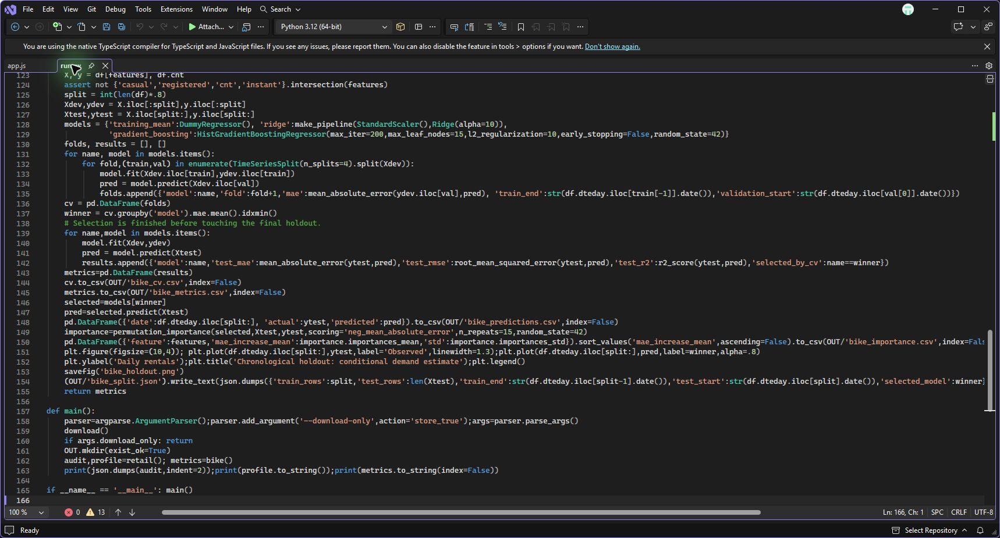
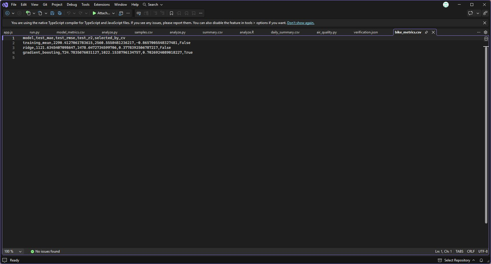
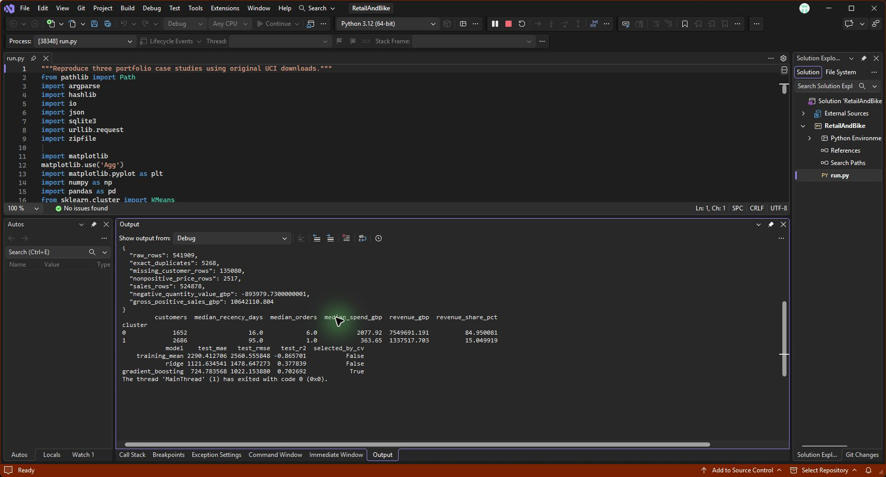
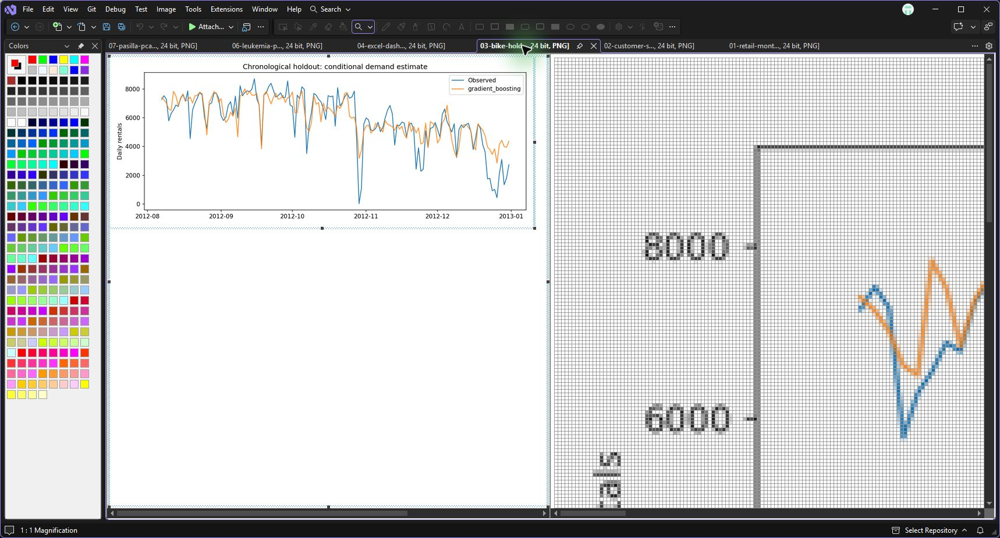
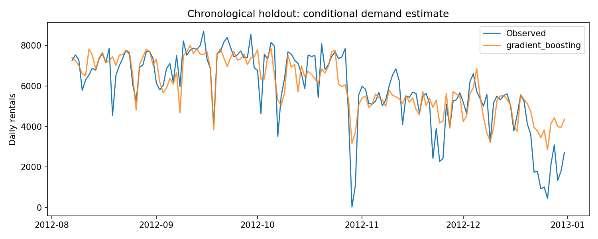

# Estimating daily bike rentals

[← All projects](../../README.md#projects) · [Source code](../../run.py) · [Results](../../reports/bike_metrics.csv)

**Tools** · Python · pandas · scikit-learn · Matplotlib

Gradient boosting had a holdout mean absolute error of **724.8 rentals per day**, compared with **1,121.6** for Ridge regression and **2,290.4** for a training-mean baseline. I compared the models on later dates kept out of model selection, using 731 daily observations from the UCI Bike Sharing dataset.

**Scope:** The inputs include observed same-day weather. This is a conditional demand estimate. A day-ahead forecast would need weather forecasts available at prediction time and a new backtest.

## Keeping later dates separate

I sorted the two years of data by date with pandas. The first **584 days (80%)** are development data; the final **147 days (20%)** are the chronological holdout. It starts on **7 August 2012**, so it covers only part of the seasonal cycle.

I used four expanding-window `TimeSeriesSplit` folds on the development data to compare the training-mean baseline, standardized Ridge regression and histogram gradient boosting. Each fold trains on past observations and scores the following window. The lowest mean validation MAE selects the model before holdout evaluation. All three holdout scores are reported, without reselecting the winner from them. [Open the implementation](../../run.py#L132-L136).

```python
    for fold,(train,val) in enumerate(TimeSeriesSplit(n_splits=4).split(Xdev)):
        model.fit(Xdev.iloc[train],ydev.iloc[train])
        pred = model.predict(Xdev.iloc[val])
        folds.append({'model':name,'fold':fold+1,'mae':mean_absolute_error(ydev.iloc[val],pred), 'train_end':str(df.dteday.iloc[train[-1]].date()),'validation_start':str(df.dteday.iloc[val[0]].date())})
cv = pd.DataFrame(folds)
```



Inputs include a calendar trend, annual sine and cosine features encoded with NumPy, holidays, working-day status, temperature, humidity and wind. I excluded row identifiers and raw dates. I also excluded `casual` and `registered`: their sum equals the target, `cnt`, so including them would reveal the answer.

The Ridge preprocessing stays inside a scikit-learn pipeline:

```python
make_pipeline(StandardScaler(), Ridge(alpha=10))
```

Fitting this pipeline within each fold keeps the scaling parameters tied to that training window. Scaling the full dataset before splitting would let later observations influence preprocessing.

## Run the analysis and read the results

Follow the [Python setup](../../README.md#run-locally), open the repository folder in Visual Studio, and run `python run.py` from the repository root in the Visual Studio terminal. Open [bike_metrics.csv](../../reports/bike_metrics.csv) for the saved metrics.



The shared script prints the holdout results in the Python debugger output. Gradient boosting's rounded MAE is about 725 rentals per day.



I used Matplotlib to compare observed rentals with predictions on the final holdout. Large gaps between the lines are individual misses.

[](../../reports/bike_holdout.png)



The outputs include the split boundaries and predictions as well as the scores:

- [Expanding-window CV](../../reports/bike_cv.csv)
- [Holdout MAE, RMSE, R²](../../reports/bike_metrics.csv)
- [Date boundaries](../../reports/bike_split.json)
- [Predictions](../../reports/bike_predictions.csv)
- [Permutation importance](../../reports/bike_importance.csv)
- [Measured findings](../../reports/FINDINGS.md)

MAE is the average absolute daily rental error. RMSE gives more weight to large misses, while negative R² can indicate poor extrapolation. Permutation importance measures predictive sensitivity rather than causality; correlated weather and seasonal features make it harder to interpret.

## What still needs testing

This dataset covers only two years in one city. A good result on this particular holdout does not establish the same performance across seasons or cities. I would add rolling seasonal backtests and a lag-based operational baseline before using the model for staffing or inventory decisions.

For day-ahead forecasting, I would replace observed weather with forecasts available at each prediction time and repeat the evaluation.
