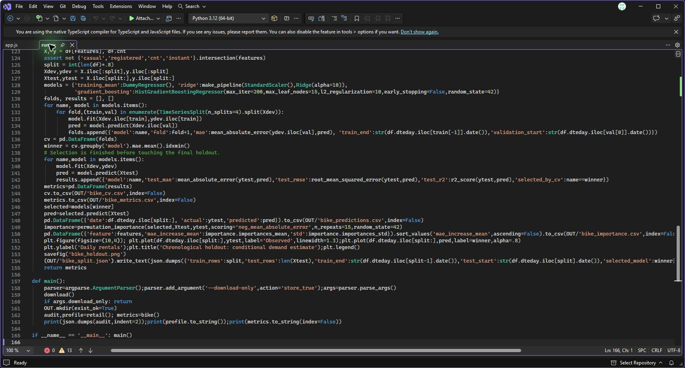
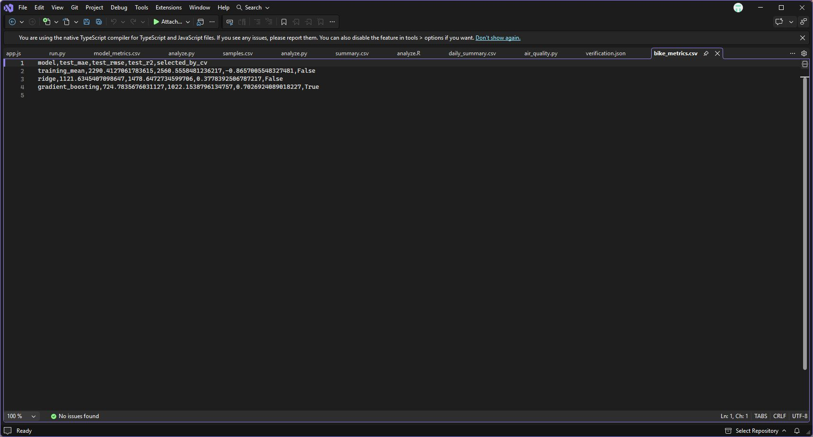
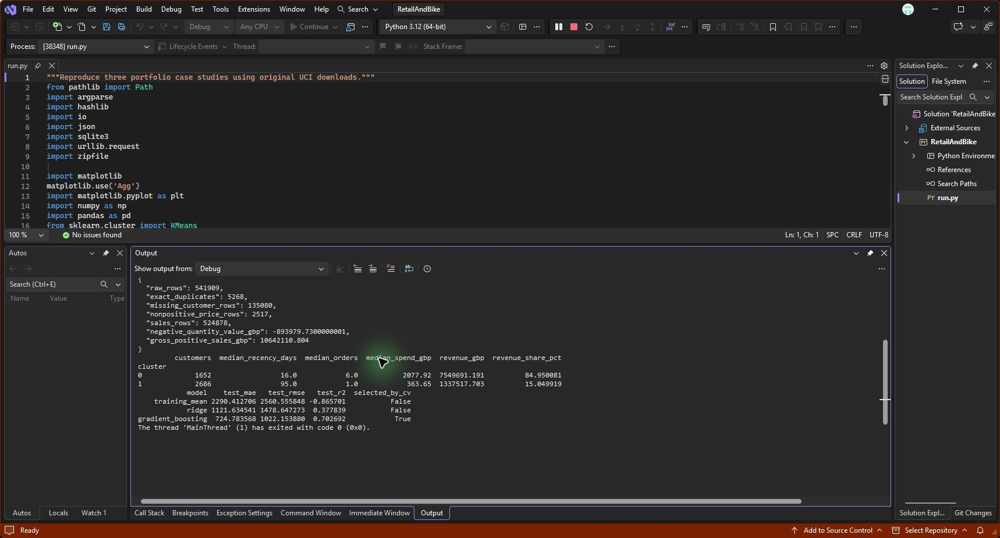
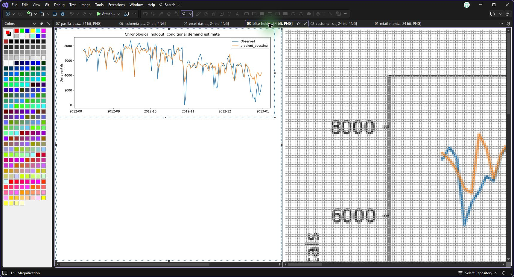

# Estimating daily bike rentals

[← All projects](../../README.md#projects) · [Source code](../../run.py) · [Results](../../reports/bike_metrics.csv)

**Tools** · Python · pandas · scikit-learn · Matplotlib

This project compares a simple baseline, Ridge regression and gradient boosting on two years of bike rental data. Keeping later dates out of model selection is the main focus.

## Questions I wanted to answer

1. Can Ridge regression or gradient boosting improve on a training-mean baseline?
2. Does that improvement hold on later dates that were not used to select the model?
3. What information would be available when making a real prediction?

## Tools and why I used them

| Tool | Role in this project |
|---|---|
| pandas | Load daily observations, sort dates and construct chronological subsets |
| NumPy | Encode the annual cycle with sine and cosine |
| scikit-learn | Build models and a scaling pipeline, run expanding-window validation, calculate errors and permutation importance |
| Matplotlib | Compare observed rentals with predictions on the final holdout |

## Code and results in Visual Studio

1. **Hold out the most recent dates.** I sorted 731 UCI Bike Sharing days by date and reserved the final fifth for evaluation. I excluded casual and registered counts because their sum gives away the target.
2. **Validate forward in time.** I used scikit-learn TimeSeriesSplit on the earlier dates, fit each model using past observations and scored it on the following window. I chose the model before opening the final holdout. [Open the implementation](../../run.py#L132-L136).

```python
    for fold,(train,val) in enumerate(TimeSeriesSplit(n_splits=4).split(Xdev)):
        model.fit(Xdev.iloc[train],ydev.iloc[train])
        pred = model.predict(Xdev.iloc[val])
        folds.append({'model':name,'fold':fold+1,'mae':mean_absolute_error(ydev.iloc[val],pred), 'train_end':str(df.dteday.iloc[train[-1]].date()),'validation_start':str(df.dteday.iloc[val[0]].date())})
cv = pd.DataFrame(folds)
```



3. **Run the analysis.** Open the repository folder in Visual Studio, follow the [Python setup](../../README.md#run-locally), then run `python run.py` from the repository root in the Visual Studio terminal.
4. **Inspect the output.** Open [bike_metrics.csv](../../reports/bike_metrics.csv) in Visual Studio. The chart below is generated by the same run.



**Visual Studio Output.** The Python debugger displayed the holdout results from `run.py`. Gradient boosting had a mean absolute error of about 725 rentals.



[](../../reports/bike_holdout.png)


5. **Interpret the result.** Gradient boosting averaged 725 rentals of absolute error per day versus 2,290 for the training-mean baseline. Large gaps between lines are individual misses. Weather was observed the same day.

## Evaluation design

The analysis uses all 731 daily observations, sorted by date. The first 80% are development data and the final 20% form an untouched chronological holdout during model selection. Four expanding-window folds compare a training-mean baseline, standardized Ridge regression, and histogram gradient boosting. The lowest mean validation MAE selects the model before final holdout evaluation. All model holdout scores are reported transparently; the winner is not reselected based on those scores.

Inputs include a calendar trend, cyclical annual features, holidays, working-day status, temperature, humidity, and wind. The target is `cnt`. `casual` and `registered` are excluded because their sum is the target. Row identifiers and raw dates are excluded.

**Scope:** Weather values are same-day observations. This is a conditional demand estimate, not a validated day-ahead forecasting system. A real forecast would need weather forecasts available at prediction time and a new backtest.

## Deliverables

- [Expanding-window CV](../../reports/bike_cv.csv)
- [Holdout MAE, RMSE, R²](../../reports/bike_metrics.csv)
- [Date boundaries](../../reports/bike_split.json)
- [Predictions](../../reports/bike_predictions.csv)
- [Permutation importance](../../reports/bike_importance.csv)
- [Measured findings](../../reports/FINDINGS.md)

MAE is interpretable as average absolute daily rental error. RMSE emphasizes large misses; negative R² can reveal poor extrapolation. Permutation importance measures predictive sensitivity, not causality. Correlated weather and seasonal features complicate interpretation. The dataset contains only two years from one city, and the final holdout covers a particular season. Extend to rolling seasonal backtests and compare operational lag baselines before using the model for staffing or inventory decisions.

## What I learned

- **The split must match the intended use.** Keeping later dates separate asks whether the model can generalize forward in time. A random split would answer a different question.
- **Leakage can look like an excellent feature.** `casual + registered = cnt`, so those columns reveal the target. Excluding them is necessary before comparing models.
- **A baseline makes an error meaningful.** Gradient boosting's holdout MAE is **724.8 rentals/day**, compared with **2,290.4** for the training mean and **1,121.6** for Ridge. Those comparisons give context that a single score cannot.
- **Prediction-time availability limits the claim.** The model uses observed same-day weather. Its result supports conditional demand estimation, not a tested day-ahead forecast.

## Challenges and decisions

Only **584 days** are available for development, with the final **147 days** reserved for evaluation. I use four expanding-window folds and select the model from validation MAE before evaluating the holdout.

The Ridge preprocessing is inside a scikit-learn pipeline:

```python
make_pipeline(StandardScaler(), Ridge(alpha=10))
```

Fitting that pipeline within each fold keeps its scaling parameters tied to the training window. Scaling the full dataset before splitting would allow later observations to influence preprocessing.

The final holdout starts on **7 August 2012**, so it covers only part of the seasonal cycle. A strong result there cannot establish equally good performance in every season or city.

## What I would improve next

I would add rolling seasonal backtests and a lag-based operational baseline. To move toward day-ahead forecasting, I would replace observed weather with forecasts that were available at each prediction time, then repeat the evaluation.
