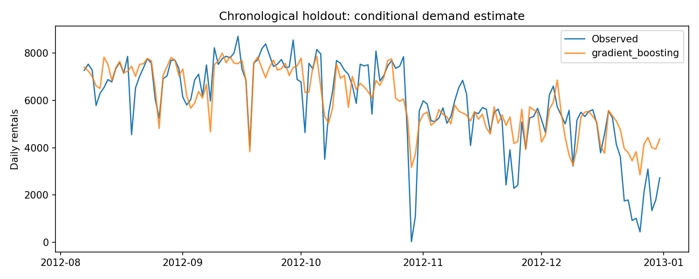

# 03 · Time-aware bike demand modeling

**Decision:** How much daily demand variation can calendar and weather explain?

## Evaluation design

The analysis uses all 731 daily observations, sorted by date. The first 80% are development data and the final 20% form an untouched chronological holdout during model selection. Four expanding-window folds compare a training-mean baseline, standardized Ridge regression, and histogram gradient boosting. The lowest mean validation MAE selects the model before final holdout evaluation. All model holdout scores are reported transparently; the winner is not reselected based on those scores.

Inputs include a calendar trend, cyclical annual features, holidays, working-day status, temperature, humidity, and wind. The target is `cnt`. `casual` and `registered` are excluded because their sum is the target. Row identifiers and raw dates are excluded.

**Scope:** Weather values are same-day observations. This is a conditional demand estimate, not a validated day-ahead forecasting system. A real forecast would need weather forecasts available at prediction time and a new backtest.

## Deliverables

- [Expanding-window CV](../../reports/bike_cv.csv)
- [Holdout MAE, RMSE, R²](../../reports/bike_metrics.csv)
- [Date boundaries](../../reports/bike_split.json)
- [Predictions](../../reports/bike_predictions.csv)
- [Permutation importance](../../reports/bike_importance.csv)
- [Measured findings](../../reports/FINDINGS.md)

MAE is interpretable as average absolute daily rental error. RMSE emphasizes large misses; negative R² can reveal poor extrapolation. Permutation importance measures predictive sensitivity, not causality. Correlated weather and seasonal features complicate interpretation. The dataset contains only two years from one city, and the final holdout covers a particular season. Extend to rolling seasonal backtests and compare operational lag baselines before using the model for staffing or inventory decisions.

**Interview discussion:** Why avoid random splits? Why can tree models struggle with a growing trend? What would change for a genuine day-ahead forecast?
