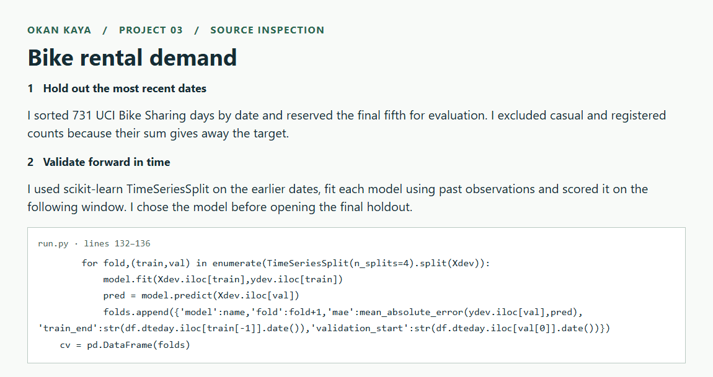
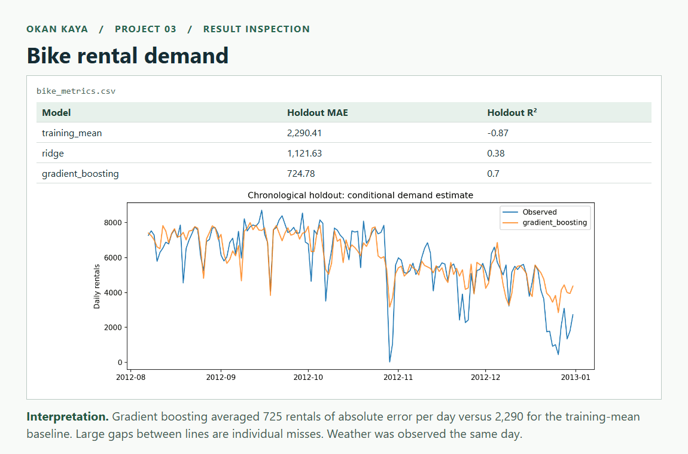

# Estimating daily bike rentals

[← All projects](../../README.md#projects) · [Source code](../../run.py) · [Results](../../reports/bike_metrics.csv)

**Tools** · Python · pandas · scikit-learn · Matplotlib

This project compares a simple baseline, Ridge regression and gradient boosting on two years of bike rental data. Keeping later dates out of model selection is the main focus.

## Step-by-step walkthrough

1. **Hold out the most recent dates.** I sorted 731 UCI Bike Sharing days by date and reserved the final fifth for evaluation. I excluded casual and registered counts because their sum gives away the target.
2. **Validate forward in time.** I used scikit-learn TimeSeriesSplit on the earlier dates, fit each model using past observations and scored it on the following window. I chose the model before opening the final holdout. [Open the implementation](../../run.py#L132-L136).

```python
    for fold,(train,val) in enumerate(TimeSeriesSplit(n_splits=4).split(Xdev)):
        model.fit(Xdev.iloc[train],ydev.iloc[train])
        pred = model.predict(Xdev.iloc[val])
        folds.append({'model':name,'fold':fold+1,'mae':mean_absolute_error(ydev.iloc[val],pred), 'train_end':str(df.dteday.iloc[train[-1]].date()),'validation_start':str(df.dteday.iloc[val[0]].date())})
cv = pd.DataFrame(folds)
```

<details>
<summary>Open the annotated code screenshot</summary>



</details>

3. **Inspect the output.** Open [bike_metrics.csv](../../reports/bike_metrics.csv) and the [analysis figure](../../reports/bike_holdout.png). The screenshot puts the saved output beside a short explanation.
4. **Interpret the result.** Gradient boosting averaged 725 rentals of absolute error per day versus 2,290 for the training-mean baseline. Large gaps between lines are individual misses. Weather was observed the same day.



## Evaluation design

The analysis uses all 731 daily observations, sorted by date. The first 80% are development data and the final 20% form an untouched chronological holdout during model selection. Four expanding-window folds compare a training-mean baseline, standardized Ridge regression, and histogram gradient boosting. The lowest mean validation MAE selects the model before final holdout evaluation. All model holdout scores are reported transparently; the winner is not reselected based on those scores.

Inputs include a calendar trend, cyclical annual features, holidays, working-day status, temperature, humidity, and wind. The target is `cnt`. `casual` and `registered` are excluded because their sum is the target. Row identifiers and raw dates are excluded.

**Scope:** Weather values are same-day observations. This is a conditional demand estimate, not a validated day-ahead forecasting system. A real forecast would need weather forecasts available at prediction time and a new backtest.


## Deliverables

- [Expanding-window CV](../../reports/bike_cv.csv)
- [Holdout MAE, RMSE, R²](../../reports/bike_metrics.csv)
- [Date boundaries](../../reports/bike_split.json)
- [Predictions](../../reports/bike_predictions.csv)
- [Permutation importance](../../reports/bike_importance.csv)
- [Measured findings](../../reports/FINDINGS.md)

MAE is interpretable as average absolute daily rental error. RMSE emphasizes large misses; negative R² can reveal poor extrapolation. Permutation importance measures predictive sensitivity, not causality. Correlated weather and seasonal features complicate interpretation. The dataset contains only two years from one city, and the final holdout covers a particular season. Extend to rolling seasonal backtests and compare operational lag baselines before using the model for staffing or inventory decisions.
