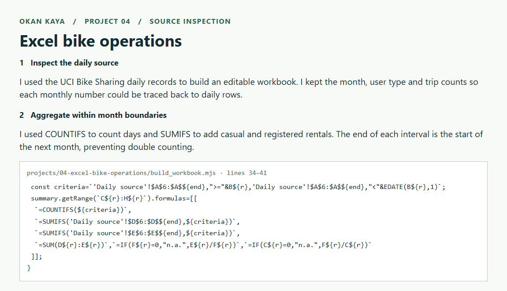
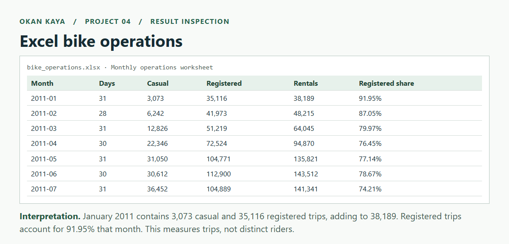

# 04 · Excel bike operations dashboard

**Question:** How do monthly rental volume and registered-user mix change across 2011–2012?

Download [bike_operations.xlsx](bike_operations.xlsx) and open it in Excel. The workbook contains 731 daily source records and a formula-driven monthly report with a native editable line chart. Source counts stay numeric, dates are Excel dates, the source is filterable, and its headers are frozen.

## Step-by-step walkthrough

1. **Inspect the daily source.** I used the UCI Bike Sharing daily records to build an editable workbook. I kept the month, user type and trip counts so each monthly number could be traced back to daily rows.
2. **Aggregate within month boundaries.** I used COUNTIFS to count days and SUMIFS to add casual and registered rentals. The end of each interval is the start of the next month, preventing double counting. [Open the implementation](build_workbook.mjs#L34-L41).

3. **Inspect the output.** Open [bike_operations.xlsx](bike_operations.xlsx). The browser capture below shows values from that artifact as a worksheet extract.
4. **Interpret the result.** January 2011 contains 3,073 casual and 35,116 registered trips, adding to 38,189. Registered trips account for 91.95% that month. This measures trips, not distinct riders.

## Reading the figure

The workbook aggregates trips, so the registered share of 81.17% describes trips taken by registered riders. One frequent rider can contribute many trips. The reconciled total of 3,292,679 checks the aggregation; it does not identify 3.29 million distinct riders.

[Inspect the underlying result](../../projects/04-excel-bike-operations/bike_operations.xlsx)

## Excel skills demonstrated

- Bounded `SUMIFS` and `COUNTIFS` with inclusive month starts and exclusive next-month boundaries.
- `EDATE`, zero-denominator handling, aggregate registered share, and daily averages.
- A source-to-summary reconciliation and conditional formatting for a nonzero difference.
- Cell-linked chart series and consistent number/date formats.

**Measured results:** 3,292,679 rentals over 731 days. Registered rentals account for 81.17% of total rentals. These are rentals, not distinct customers. Monthly totals alone cannot establish why demand changes.

## Refresh and verification

The report covers the fixed January 2011–December 2012 window. Editing source counts recalculates the report. Appending new dates requires extending the bounded formula ranges and report months. The summary recomputes totals from casual and registered counts, while the check compares against the source total column, making inconsistent source edits visible.

The artifact calculation engine verified the full total and tested a temporary +10 change to a source count before restoring it. Both sheets were rendered and reviewed. Exported formula caches and chart cell references were inspected. Native Excel desktop recalculation was not separately exercised.

For regeneration, run `python run.py --download-only`, then `python projects/04-excel-bike-operations/prepare_data.py`. The optional JavaScript authoring script uses `@oai/artifact-tool` in the Codex workspace runtime; the delivered `.xlsx` requires no authoring dependency to use. See [verification.json](verification.json).

**Source:** Fanaee-T, H. (2013), [UCI Bike Sharing](https://archive.ics.uci.edu/dataset/275/bike+sharing+dataset), [DOI](https://doi.org/10.24432/C5W894), CC BY 4.0. The workbook embeds selected original daily columns; the original archive hash is in the repository's data provenance.
