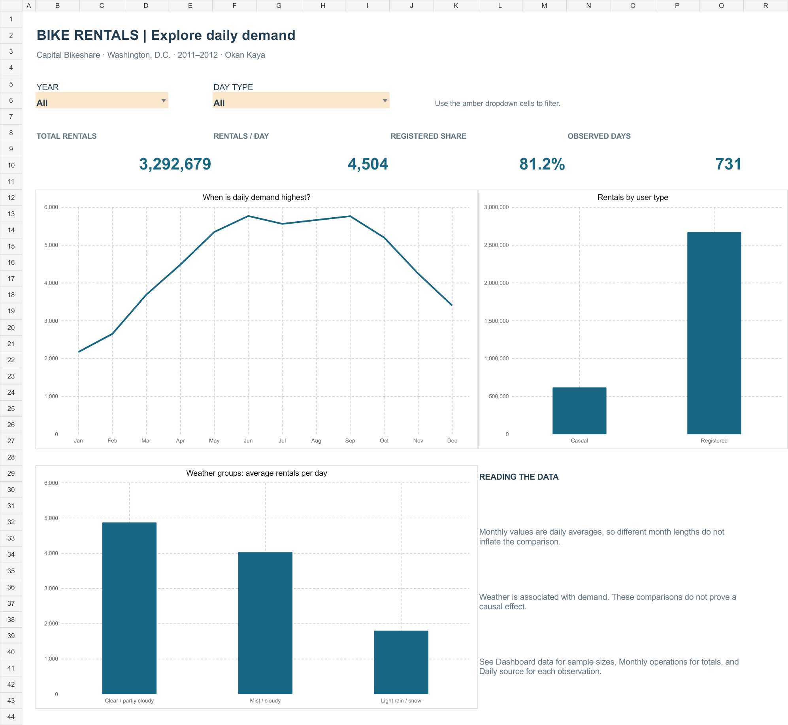
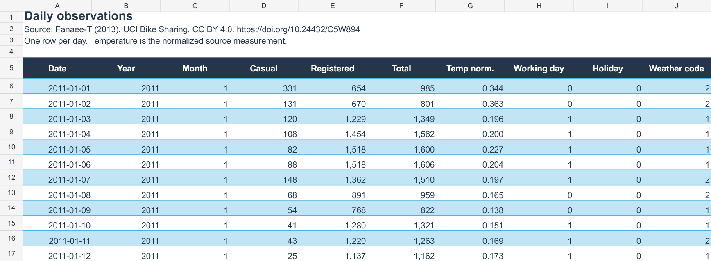
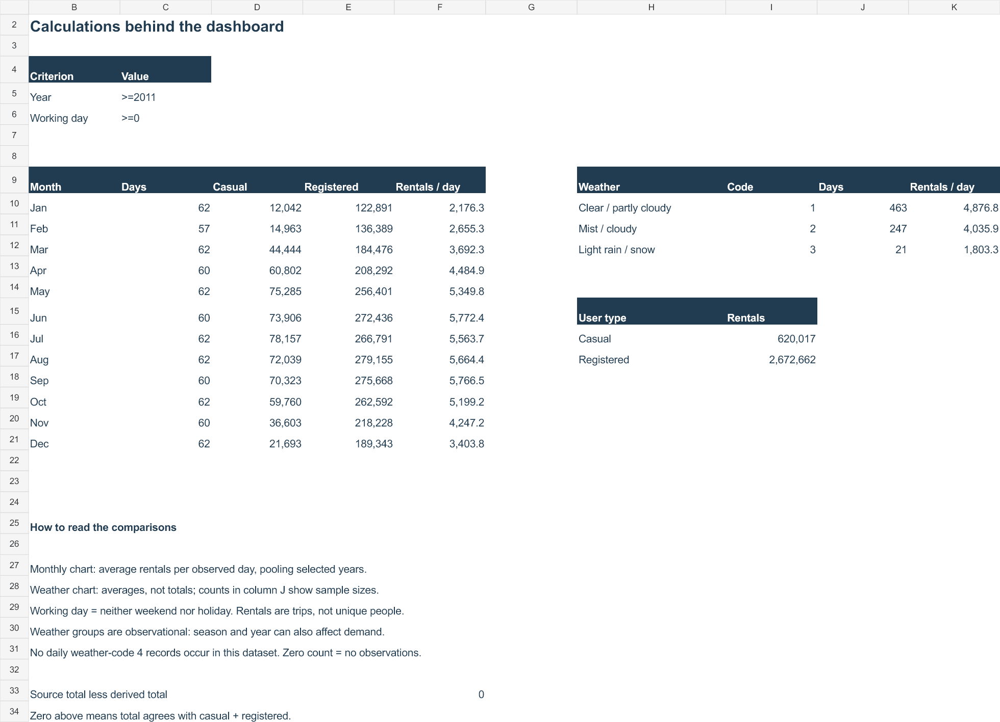
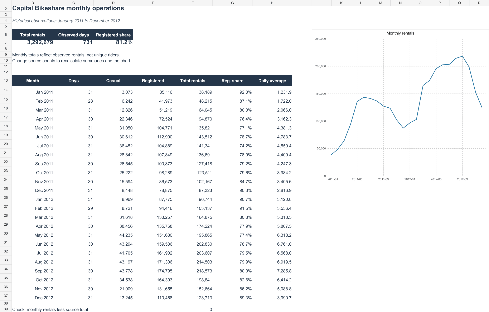
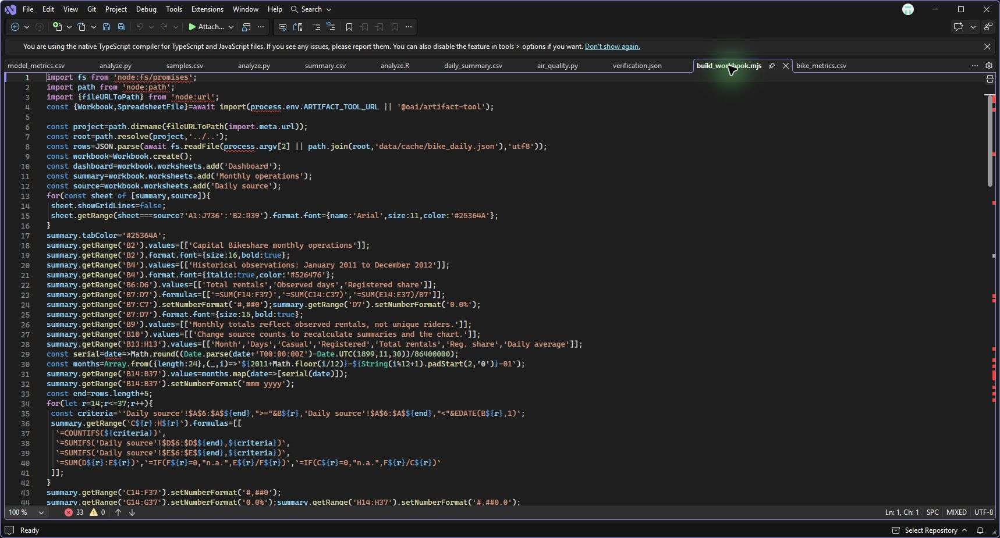
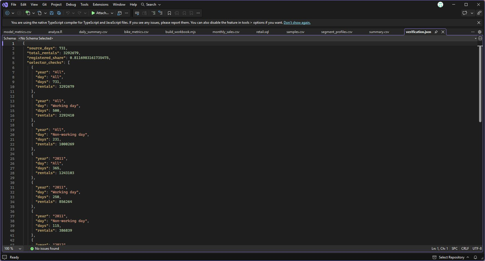
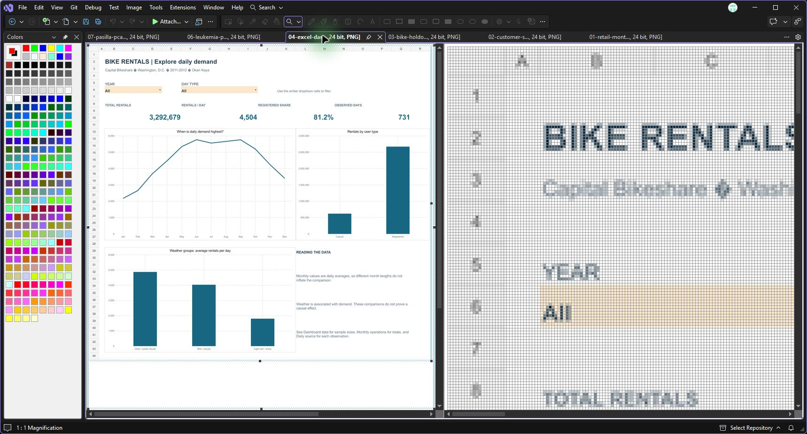

# Bike rental dashboard in Excel

[← All projects](../../README.md#projects) · [Download the workbook](https://github.com/OkanKaya07/data-science-portfolio/raw/refs/heads/main/projects/04-excel-bike-operations/bike_operations.xlsx) · [Build script](build_workbook.mjs)

I wanted to turn my monthly bike rental report into something a reader could explore. This version adds year and day-type filters, a seasonal demand chart, a user-type comparison and a weather comparison. The original monthly report is still in the workbook.



**Tools:** Excel · SUMIFS · COUNTIFS · IF · EDATE · Data Validation · native Excel charts  
**Data:** 731 daily Capital Bikeshare observations from Washington, D.C., January 2011–December 2012.

## Try it

1. Download **[bike_operations.xlsx](https://github.com/OkanKaya07/data-science-portfolio/raw/refs/heads/main/projects/04-excel-bike-operations/bike_operations.xlsx)** and open it in Excel.
2. On **Dashboard**, change the amber **Year** and **Day type** dropdowns.
3. Compare 2011 with 2012, then working days with non-working days. All three dashboard charts and the four metrics use the same selection.
4. Open **Dashboard data** to see the counts and calculations behind the charts.

No macros or external data connection are required. The GitHub image is a static preview; the dropdowns work in the workbook.

| Sheet | Purpose |
|---|---|
| Dashboard | Filtered metrics and charts |
| Monthly operations | The complete 24-month report, independent of dashboard filters |
| Daily source | Original daily observations in a filterable Excel table |
| Dashboard data | Formula-backed chart data, sample sizes and calculation notes |

## What I found

These results use **All years / All day types** unless a year is specified.

| Question | Result | What it means |
|---|---|---|
| How much activity is represented? | **3,292,679 rentals** across **731 days** | About **4,504 rentals per day**. These are trips, not unique people. |
| Who accounts for the rentals? | **2,672,662 registered** and **620,017 casual** rentals | Registered rentals make up **81.17%** of trips. This is a share of activity, not the share of individual customers. |
| When is average demand highest? | June: **5,772/day**; September: **5,767/day**; January: **2,176/day** | The pooled monthly pattern is much higher in warmer months. Daily averages avoid giving longer months an automatic advantage. |
| How different are the two years? | 2011: **3,406/day**; 2012: **5,600/day** | The later year has substantially higher observed demand. Selecting a year helps separate this change from the pooled seasonal pattern. |
| How does demand vary with weather? | Clear/partly cloudy: **4,877/day**; mist/cloudy: **4,036/day**; light rain/snow: **1,803/day** | Worse weather is associated with fewer rentals, but this comparison does not control for season, year or other factors. |

The weather groups contain **463**, **247** and **21 days**, respectively. The light-rain/snow estimate has a much smaller sample. I would not describe the difference as a causal weather effect.

## How I built it

### 1. Keep the daily records available

I kept date, year, month, casual and registered rental counts, the original total, normalized temperature, working-day flag, holiday flag and weather code. Each row represents one day.

A working day is neither a weekend nor a holiday. Weather labels are shortened descriptions of the UCI categories. The daily dataset has no observations in weather category 4.



### 2. Turn dropdown choices into formula criteria

The two dropdowns use **Data Validation**. On the calculation sheet, these formulas convert the selections into criteria:

```excel
=IF(Dashboard!B6="All",">=2011",Dashboard!B6)
=IF(Dashboard!F6="All",">=0",IF(Dashboard!F6="Working day",1,0))
```

For example, January's casual rentals are calculated with:

```excel
=SUMIFS('Daily source'!$D$6:$D$736,
        'Daily source'!$B$6:$B$736,$C$5,
        'Daily source'!$H$6:$H$736,$C$6,
        'Daily source'!$C$6:$C$736,1)
```

I use the same criteria in **COUNTIFS** to count observed days, and a second **SUMIFS** for registered rentals. Daily average is the sum of both rental types divided by observed days:

```excel
=IF(C10=0,0,SUM(D10:E10)/C10)
```

The zero-count guard prevents division errors. Always check the day count: zero observations is not evidence of zero demand. All nine supplied filter combinations contain observations in every displayed month and weather group.

### 3. Connect the charts to the calculations

The monthly chart uses **rentals per day**, the user chart uses **trip totals**, and the weather chart uses **rentals per day within each weather category**. Each answers a different question.

All charts are native, editable Excel charts connected to cells. The dashboard is formula-driven; it does not claim to use PivotTables, Power Query or DAX.



### 4. Preserve the monthly report and check the totals

The original report uses inclusive month starts and exclusive next-month boundaries with **EDATE**. It keeps all 24 months visible so readers can inspect the chronological pattern.



The report sums casual and registered counts, then compares that result with the original source-total column. The difference is **0**. Editing a component without updating the original total makes the discrepancy visible.

## Checks and limitations

- Compared totals, day counts, monthly averages and weather averages with independent calculations for **all nine selector combinations**.
- Temporarily added **10 rentals** to a source cell: the dashboard updated and the reconciliation flagged the inconsistency. Restored the original value afterward.
- Checked formula errors, exported values, validation lists and chart references; reviewed rendered views of all four sheets.
- See [verification.json](verification.json) for the calculation checks.

The calculations were exercised in the authoring engine, and the exported XLSX was inspected independently. Native Excel desktop interaction was not separately tested.

This workbook has bounded ranges for **731 records** and a fixed **2011–2012** period. Editing existing counts recalculates the report; adding dates requires extending the formulas and month window. It is a descriptive analysis of historical data, not a demand forecast.

## Reproduce the workbook

From the repository root:

```bash
python run.py --download-only
python projects/04-excel-bike-operations/prepare_data.py
node projects/04-excel-bike-operations/build_workbook.mjs
```

The JavaScript builder uses `@oai/artifact-tool` in the Codex runtime to write Excel formulas, formatting and charts. It is not a public npm dependency assumed by this repository. The delivered workbook can be used without that runtime. The script also accepts an input JSON path and an output directory as positional arguments.

## Code and results in Visual Studio

Open [build_workbook.mjs](build_workbook.mjs) in Visual Studio to see how the workbook and its formulas are assembled.



Open [verification.json](verification.json) in the editor to inspect the checks on the workbook. Open [bike_operations.xlsx](bike_operations.xlsx) in Excel to use the dashboard shown above.



The Node builder wrote the workbook and reported nine checks, four charts and 3,292,679 total rentals. The regenerated dashboard preview is open below in Visual Studio. The workbook opens in Excel for filter interaction.

[](dashboard.png)

## Source and inspiration

**Dataset:** Fanaee-T, H. (2013), [UCI Bike Sharing](https://archive.ics.uci.edu/dataset/275/bike+sharing+dataset), [DOI: 10.24432/C5W894](https://doi.org/10.24432/C5W894), CC BY 4.0. Original archive hashes are recorded in [data/provenance.json](../../data/provenance.json).

**Presentation inspiration:** Luke Barousse's [Excel Data Analytics Course](https://github.com/lukebarousse/Excel_Data_Analytics_Course), particularly its dashboard-first layout, dropdown controls and question-led project explanations. I adapted that approach to the bike dataset; this is not the course's salary project.

Built with AI assistance, as noted in the portfolio README. The source, formulas and checks are included so the work can be inspected and reproduced.
