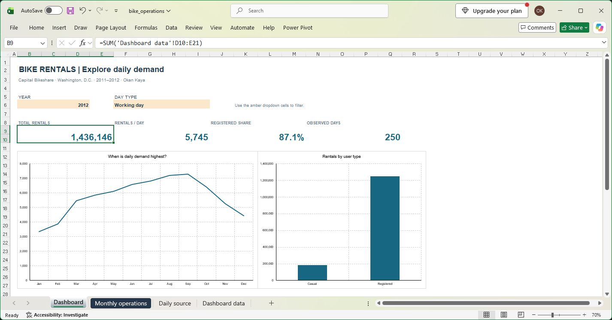
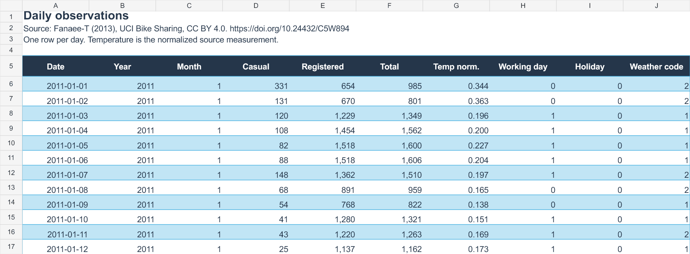
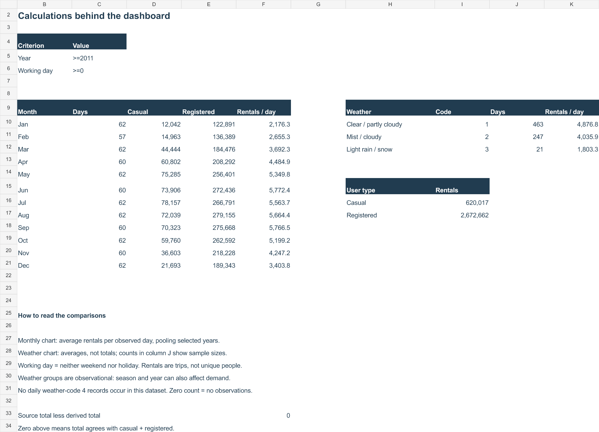
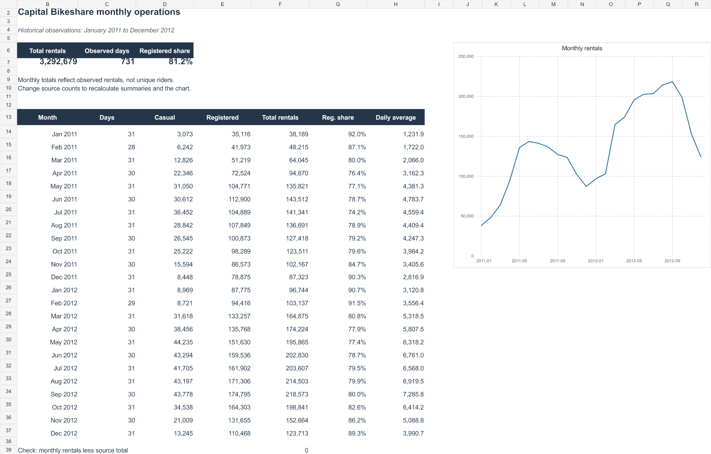
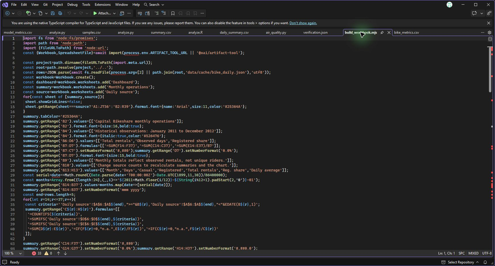
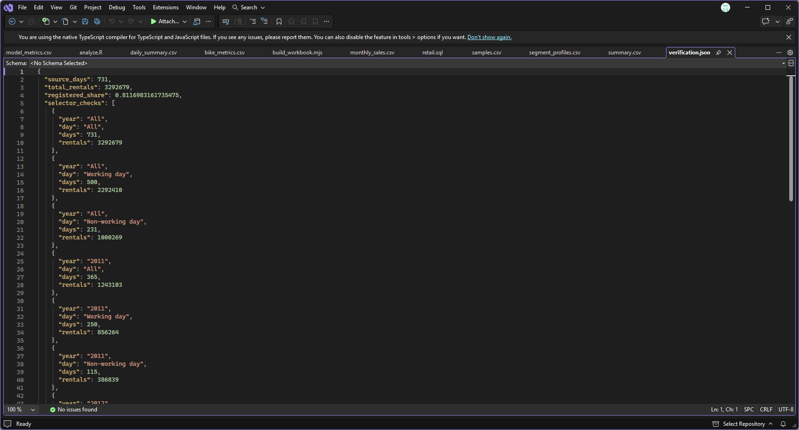

# Bike rental dashboard in Excel

[← All projects](../../README.md#projects) · [Download the workbook](https://github.com/OkanKaya07/data-science-portfolio/raw/refs/heads/main/projects/04-excel-bike-operations/bike_operations.xlsx) · [Build script](build_workbook.mjs)

With **2012 / Working day** selected, this dashboard shows **1,436,146 rentals over 250 days**. I added year and day-type filters to my monthly bike rental report so readers can compare seasonal demand, user types and weather. I kept the original monthly report in a separate sheet.



The formula bar shows how the selected total is calculated.

**Tools:** Excel · SUMIFS · COUNTIFS · IF · EDATE · Data Validation · native Excel charts  
**Data:** 731 daily Capital Bikeshare observations from Washington, D.C., January 2011–December 2012.

## Open and explore

1. Download **[bike_operations.xlsx](https://github.com/OkanKaya07/data-science-portfolio/raw/refs/heads/main/projects/04-excel-bike-operations/bike_operations.xlsx)** and open it in Excel.
2. Change the amber **Year** and **Day type** dropdowns on **Dashboard**. All four metrics and three charts use the same selection.
3. Compare 2011 with 2012, then working days with non-working days.
4. Open **Dashboard data** to inspect the counts and calculations.

The workbook needs no macros or external data connection. The image above is a static preview; the dropdowns work in Excel.

| Sheet | Contents |
|---|---|
| Dashboard | Filtered metrics and charts |
| Monthly operations | All 24 months, independent of dashboard filters |
| Daily source | Original observations in a filterable table |
| Dashboard data | Chart formulas, sample sizes and calculation notes |

## What the data shows

These figures use **All years / All day types** unless a year is specified.

| Measure | Result | Reading the result |
|---|---|---|
| Total activity | **3,292,679 rentals** across **731 days**, about **4,504/day** | These are trips, not unique people. |
| User types | **2,672,662 registered**, **620,017 casual**; registered share **81.17%** | The share describes activity, not individual customers. |
| Monthly daily averages | June **5,772**; September **5,767**; January **2,176** | Warmer months have higher pooled demand. Daily averages avoid favoring longer months. |
| Yearly daily averages | 2011 **3,406**; 2012 **5,600** | Selecting a year helps separate the increase from the pooled seasonal pattern. |
| Weather daily averages | Clear/partly cloudy **4,877**; mist/cloudy **4,036**; light rain/snow **1,803** | The comparison does not control for season, year or other factors. |

The weather groups contain **463**, **247** and **21 days**, respectively. The light-rain/snow estimate has a much smaller sample, and these differences do not establish a causal weather effect.

## From daily rows to dashboard formulas

I kept one row per day: date, year, month, casual and registered counts, the original total, normalized temperature, working-day and holiday flags, and weather code. A working day is neither a weekend nor a holiday. Weather labels shorten the UCI descriptions; category 4 has no observations in this daily dataset.



The dropdowns use **Data Validation**. These formulas on the calculation sheet turn the selections into criteria:

```excel
=IF(Dashboard!B6="All",">=2011",Dashboard!B6)
=IF(Dashboard!F6="All",">=0",IF(Dashboard!F6="Working day",1,0))
```

January's casual rentals, for example, use:

```excel
=SUMIFS('Daily source'!$D$6:$D$736,
        'Daily source'!$B$6:$B$736,$C$5,
        'Daily source'!$H$6:$H$736,$C$6,
        'Daily source'!$C$6:$C$736,1)
```

I used the same criteria in **COUNTIFS** for observed days and a second **SUMIFS** for registered rentals. Daily average divides both rental types by observed days:

```excel
=IF(C10=0,0,SUM(D10:E10)/C10)
```

The guard prevents division errors. A zero day count means no observations, not zero demand. All nine supplied filter combinations have observations in every displayed month and weather group.

The monthly chart shows **rentals per day**, the user chart shows **trip totals**, and the weather chart shows **rentals per day within each category**. These are native, editable Excel charts linked to cells. The dashboard uses formulas, not PivotTables, Power Query or DAX.



The original report uses inclusive month starts and exclusive next-month boundaries with **EDATE**, keeping all 24 months in chronological order. It compares casual plus registered counts with the original source total. The difference is **0**; editing a component without updating the source total exposes the discrepancy.



## Checks and limits

I compared totals, day counts, monthly averages and weather averages with independent calculations for **all nine selector combinations**. Adding **10 rentals** temporarily to a source cell updated the dashboard and triggered the reconciliation check; I then restored the original value. I also checked formula errors, exported values, validation lists and chart references, and reviewed rendered views of all four sheets. The automated results are in [verification.json](verification.json).

In desktop Excel, selecting **2012**, then **Working day**, recalculated the metrics and refreshed all three charts.

The formulas have bounded ranges for **731 records** and a fixed **2011–2012** period. Editing existing counts recalculates the report; adding dates requires extending the ranges and month window. This describes historical demand and does not forecast it.

## Rebuild or inspect

From the repository root:

```bash
python run.py --download-only
python projects/04-excel-bike-operations/prepare_data.py
node projects/04-excel-bike-operations/build_workbook.mjs
```

The JavaScript builder uses `@oai/artifact-tool` in the Codex runtime for formulas, formatting and charts. This is not a public npm dependency assumed by the repository; the delivered workbook works without that runtime. The script also accepts an input JSON path and an output directory as positional arguments.

Open [build_workbook.mjs](build_workbook.mjs) in Visual Studio to inspect the workbook construction and formulas.



Open [verification.json](verification.json) to inspect the checks, or [bike_operations.xlsx](bike_operations.xlsx) in Excel to use the dashboard.



## Source and inspiration

**Dataset:** Fanaee-T, H. (2013), [UCI Bike Sharing](https://archive.ics.uci.edu/dataset/275/bike+sharing+dataset), [DOI: 10.24432/C5W894](https://doi.org/10.24432/C5W894), CC BY 4.0. Original archive hashes are in [data/provenance.json](../../data/provenance.json).

I adapted the dashboard-first layout, dropdown controls and question-led explanations from Luke Barousse's [Excel Data Analytics Course](https://github.com/lukebarousse/Excel_Data_Analytics_Course) to the bike data. This is not the course's salary project.

Built with AI assistance, as noted in the portfolio README. The source, formulas and checks are included so the work can be inspected and reproduced.
