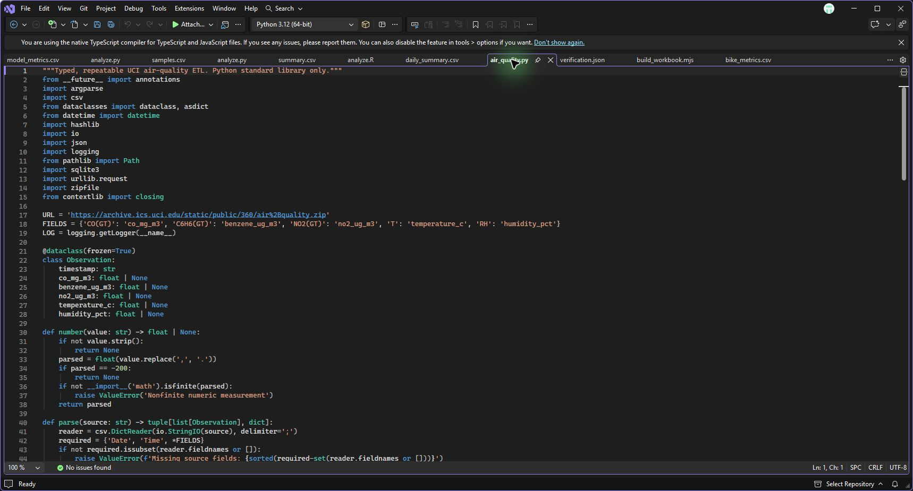
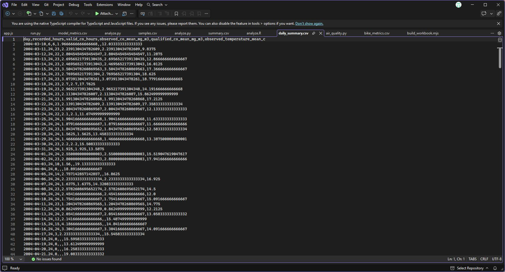
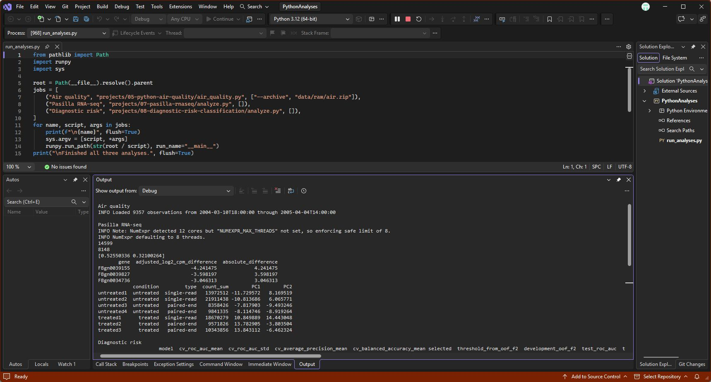
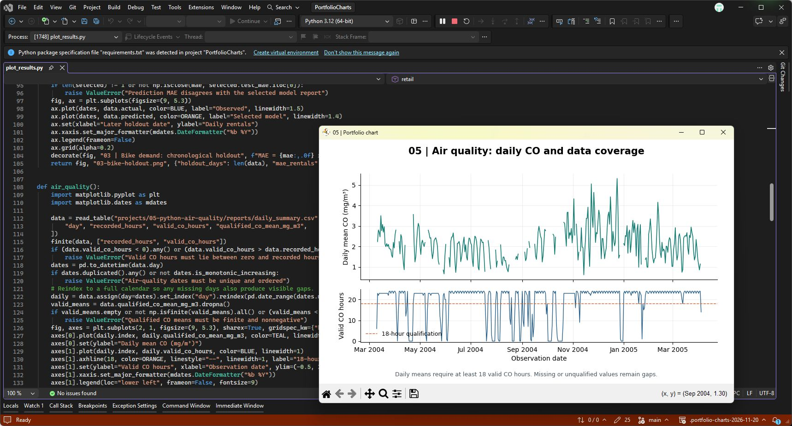

# Cleaning air-quality sensor data

[← All projects](../../README.md#projects) · [Source code](air_quality.py) · [Results](reports/daily_summary.csv)

I used Python and SQLite to turn the UCI sensor CSV into a daily report. The file contains **9,357 timestamped observations**, but some days have too few valid readings for a useful comparison. I kept the observed CO mean alongside a second mean that stays blank when coverage falls below the selected threshold.

**Tools:** Python standard library · SQLite · unittest; Matplotlib for the saved-report chart

## Run the pipeline

From the repository root, with Python 3.12:

```bash
python projects/05-python-air-quality/air_quality.py
python projects/05-python-air-quality/air_quality.py --min-hours 20
python -m unittest discover -s projects/05-python-air-quality -v
```

The default threshold is **18 valid hourly CO readings**. Use `--min-hours` to change it, `--archive` for an existing UCI ZIP, and `--output` for the output directory.

A failed parse exits with a nonzero status before touching the database. Reruns replace the table in a transaction, avoiding duplicate records. Duplicate timestamps, including conflicting readings, fail explicitly.

The outputs are [daily summaries](reports/daily_summary.csv), a [quality report and source hash](reports/quality_report.json), and a locally generated SQLite database that is Git-ignored.

## Reading the source file

The CSV uses semicolon separators, decimal commas and **−200** for missing values. I used `csv` and `datetime` for parsing, `dataclasses` for named, typed observations, and `sqlite3` for storage and aggregation. `argparse` exposes the paths and threshold, `logging` reports the run, and `hashlib` records the source hash. The dataset is small enough to handle directly without pandas, making parsing failures easy to inspect.

The numeric parser converts decimal commas before checking the missing-value marker:

```python
parsed = float(value.replace(',', '.'))
if parsed == -200:
    return None
```

Missing measurements become `None`/SQL `NULL`; real zeros stay zero. The full parser rejects malformed dates and nonfinite numbers and skips date-empty trailing lines. Timestamps retain the source's local clock values, with no inferred timezone or daylight-saving correction.

| File check | Result |
|---|---|
| Timestamped observations | **9,357**, from **10 March 2004 to 4 April 2005** |
| Trailing/date-empty rows skipped | **114** |
| Missing CO readings | **1,683** |
| Missing NO₂ readings | **1,642** |

UCI lists 9,358 instances and a shorter date description. I report the counts and dates from the supplied file; the [quality report](reports/quality_report.json) records its hash for traceability.

Five `unittest` tests pass, covering decimal/missing parsing, invalid schema/dates, duplicate timestamps, nonfinite numbers, and repeat loading. The [GitHub Actions workflow](../../.github/workflows/air-quality-tests.yml) runs this suite with Python 3.12 on relevant pushes and pull requests, and can also be started manually. These tests use synthetic input and the standard library; they need no source-data download or package installation.

## Failure example: a duplicate timestamp

From the repository root, run this in Python to repeat the small synthetic row from the [existing test fixture](test_air_quality.py):

```python
import sys
sys.path.insert(0, "projects/05-python-air-quality")
from test_air_quality import aq, HEADER, ROW

aq.parse(HEADER + ROW + ROW)
```

The parser rejects the second reading rather than choosing which value to keep:

```text
ValueError: Duplicate timestamp at CSV line 3: 2004-03-10T18:00:00
```

The pipeline parses the complete CSV before calling `load_database`. I also checked the command-line failure using a temporary ZIP containing this duplicate: it exited with status 1 and `ETL failed: Duplicate timestamp at CSV line 3: 2004-03-10T18:00:00`, while the previously loaded database remained byte-for-byte unchanged. This example is constructed input, not an extra observation from UCI.

## A daily mean needs a count

SQL `AVG` ignores NULL values, so the report counts valid CO hours separately from recorded hours. It keeps both the observed mean and the coverage-qualified mean. [The aggregation](air_quality.py#L99-L102) includes:

```python
COUNT(co_mg_m3) valid_co_hours, AVG(co_mg_m3) observed_co_mean_mg_m3,
CASE WHEN COUNT(co_mg_m3)>=? THEN AVG(co_mg_m3) END qualified_co_mean_mg_m3,
AVG(temperature_c) observed_temperature_mean_c
FROM observations GROUP BY 1 ORDER BY 1''',(min_hours,))
```



On **10 March**, six valid readings averaged **1.97 mg/m³**, leaving the qualified field blank. On **11 March**, 23 valid hours produced a qualified average of **2.24 mg/m³**. Low coverage is blank, not zero, and the separate observed mean keeps the available measurements visible. The 18-hour rule is an analytical choice, not a regulatory air-quality standard.

Open [daily_summary.csv](reports/daily_summary.csv) in Visual Studio to inspect the means and coverage counts.



The Visual Studio debugger run loaded the same **9,357 observations**:



## Plotting daily CO and coverage

The chart below reads the saved daily report. Gaps in the coverage-qualified mean remain gaps rather than becoming zero measurements. Valid-hour counts show why some days do not receive a qualified mean.



From the repository root, run `python plot_results.py --project 05 --show`. The [plotting code](../../plot_results.py) uses the existing CSV; it does not alter the pipeline's 18-hour coverage rule or impute readings.

## Source and limits

[UCI Air Quality](https://archive.ics.uci.edu/dataset/360/air+quality), De Vito et al., *On field calibration of an electronic nose for benzene estimation in an urban pollution monitoring scenario*, Sensors and Actuators B 129(2), 2008, 750–757.

The source page restricts the data to research and excludes commercial purposes. This is an educational/research project; the repository's MIT code license does not grant data rights. Raw sensor records are not committed.

The pipeline does not estimate health risk, establish regulatory compliance, impute missing readings or calibrate sensors. I would next add a run manifest with the complete command and software version, then monitor changes in missingness. Timezone-aware processing would need reliable collection metadata.
