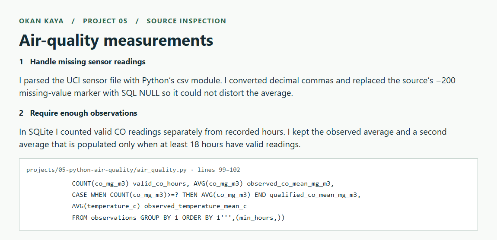
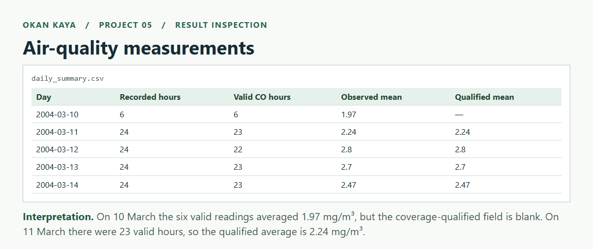

# Cleaning air-quality sensor data

[← All projects](../../README.md#projects) · [Source code](air_quality.py) · [Results](reports/daily_summary.csv)

**Tools** · Python standard library · SQLite · unittest

This is a small Python command-line application for turning a sensor CSV into daily summaries. The difficult parts of the input are decimal commas, missing-value markers and days with too few readings.

## Questions I wanted to answer

1. How can a messy sensor CSV become a repeatable daily report?
2. How should missing readings and partially observed days appear in the output?
3. Can the program reject bad input and be rerun without duplicating records?

## Tools and why I used them

| Python module | Role in this project |
|---|---|
| `csv` and `datetime` | Parse semicolon-separated fields, dates and times |
| `dataclasses` | Represent each observation with named, typed fields |
| `sqlite3` | Store observations transactionally and calculate daily summaries |
| `argparse` and `logging` | Expose input/output paths and the coverage threshold through a CLI |
| `hashlib` and `unittest` | Record the source hash and test parsing and repeat-loading behavior |

This project uses Python's standard library rather than pandas. The data handling is small enough to express directly, and explicit parsing makes failure cases easy to inspect.

## Step-by-step walkthrough

1. **Handle missing sensor readings.** I parsed the UCI sensor file with Python’s csv module. I converted decimal commas and replaced the source’s −200 missing-value marker with SQL NULL so it could not distort the average.
2. **Require enough observations.** In SQLite I counted valid CO readings separately from recorded hours. I kept the observed average and a second average that is populated only when at least 18 hours have valid readings. [Open the implementation](air_quality.py#L99-L102).

```python
COUNT(co_mg_m3) valid_co_hours, AVG(co_mg_m3) observed_co_mean_mg_m3,
CASE WHEN COUNT(co_mg_m3)>=? THEN AVG(co_mg_m3) END qualified_co_mean_mg_m3,
AVG(temperature_c) observed_temperature_mean_c
FROM observations GROUP BY 1 ORDER BY 1''',(min_hours,))
```

<details>
<summary>Open the annotated code screenshot</summary>



</details>

3. **Inspect the output.** Open [daily_summary.csv](reports/daily_summary.csv). The screenshot puts the saved output beside a short explanation.
4. **Interpret the result.** On 10 March the six valid readings averaged 1.97 mg/m³, but the coverage-qualified field is blank. On 11 March there were 23 valid hours, so the qualified average is 2.24 mg/m³.



## Run

From the repository root, with Python 3.12:

```bash
python projects/05-python-air-quality/air_quality.py
python projects/05-python-air-quality/air_quality.py --min-hours 20
python -m unittest discover -s projects/05-python-air-quality -v
```

Use `--archive` to supply an existing UCI ZIP and `--output` to choose the output directory. A failed parse exits with a nonzero status before touching the database. A rerun replaces the table in a transaction rather than appending duplicates. Duplicate timestamps fail explicitly, including conflicting readings.

## Data handling

The UCI CSV uses semicolon separators, decimal commas, and **−200** for missing readings. The parser converts missing values to `None`/SQL `NULL`, retains observed zeros, drops date-empty trailing lines, and rejects malformed dates and nonfinite numbers. Timestamps are the source's local clock values: no timezone or daylight-saving correction is inferred.

Daily CO averages expose both the observed mean and a coverage-qualified mean. By default, at least 18 valid hourly readings are required for the latter. Low-coverage results stay blank, not zero. This is an explicit analytical coverage rule, not a regulatory air-quality standard.

## Results from the actual file

- **9,357** timestamped rows, **10 March 2004–4 April 2005**.
- **114** trailing/date-empty rows skipped.
- **1,683** missing CO readings and **1,642** missing NO₂ readings.
- Five tests pass: decimal/missing parsing, invalid schema/dates, duplicate timestamps, nonfinite numbers, and repeat loading.

UCI lists 9,358 instances and a shorter date description. The report deliberately records the actual supplied file's row count and timestamp range rather than silently adopting the catalog metadata.

Deliverables: [daily summaries](reports/daily_summary.csv), [quality report and source hash](reports/quality_report.json), and the locally generated SQLite database (Git-ignored).

## Source and limits

[UCI Air Quality](https://archive.ics.uci.edu/dataset/360/air+quality), De Vito et al., *On field calibration of an electronic nose for benzene estimation in an urban pollution monitoring scenario*, Sensors and Actuators B 129(2), 2008, 750–757. The source page explicitly restricts the dataset to research and excludes commercial purposes. Treat this as an educational/research project, retain that restriction, and do not infer that the repository's MIT code license grants data rights. Raw sensor records are not committed.

This pipeline does not estimate a health risk, establish regulatory compliance, impute missing readings, or calibrate the sensors. Next improvements include structured run manifests, drift monitoring, and timezone-aware collection metadata.

## What I learned

- **Missing is not zero.** The source uses `-200` as a missing-value marker. Preserving it as a measurement would distort the average; replacing it with zero would also invent a value.
- **A mean needs a coverage count.** SQL `AVG` ignores NULL values, but that alone does not tell a reader whether a day contains six valid hours or twenty-three. Both the count and the mean belong in the report.
- **Repeatability includes reruns.** A program that appends the same observations twice can finish without an exception and still be wrong. Transactional table replacement makes rerunning the same input predictable.
- **Small edge cases deserve explicit tests.** Decimal commas, invalid dates, duplicate timestamps and nonfinite values each need a deliberate response.

## Challenges and decisions

The numeric parser converts the decimal convention before interpreting the source's sentinel:

```python
parsed = float(value.replace(',', '.'))
if parsed == -200:
    return None
```

The full function also rejects nonfinite values. A real zero remains zero, and SQL receives missing measurements as NULL.

The parsed file contains **9,357 timestamped observations**, including **1,683 missing CO readings**. I report the file-derived count and date range because they differ from the catalog description. The [quality report](reports/quality_report.json) records the source hash for traceability.

The default **18-hour** threshold is an analytical choice, exposed through `--min-hours`. It is not a regulatory standard. The output retains the observed mean separately so the coverage rule does not conceal the available measurements.

## What I would improve next

I would record the complete command and software version in a run manifest, then add checks for changes in missingness across runs. Timezone-aware processing would require reliable collection metadata rather than an assumed timezone.

