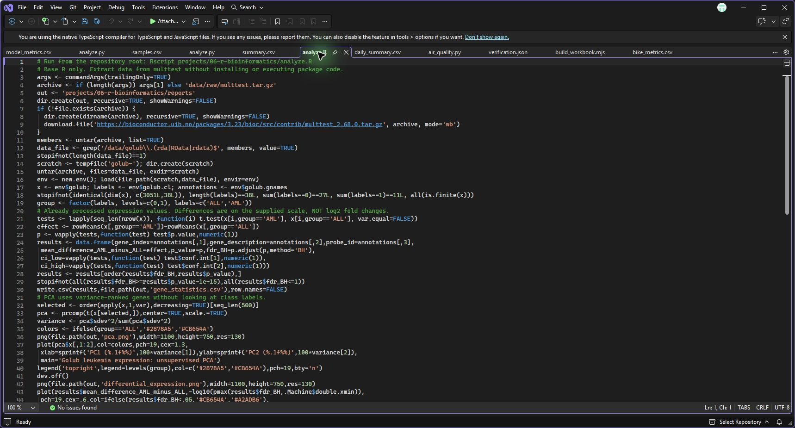
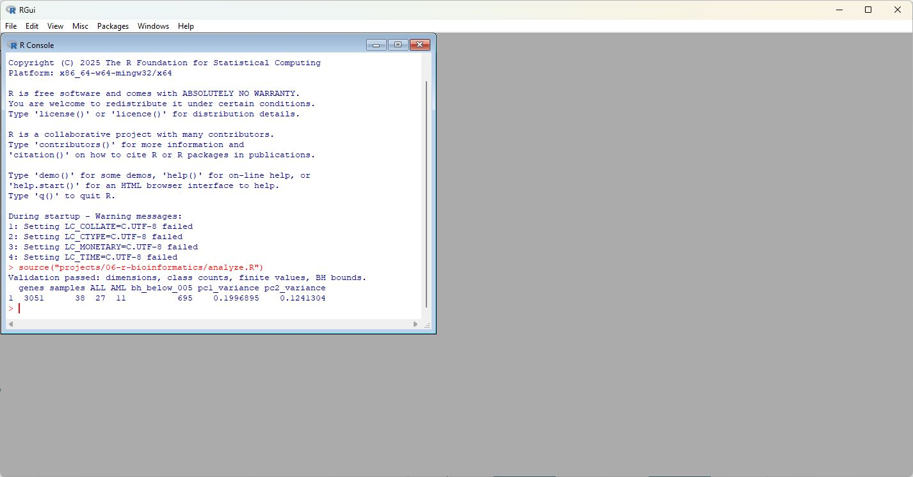
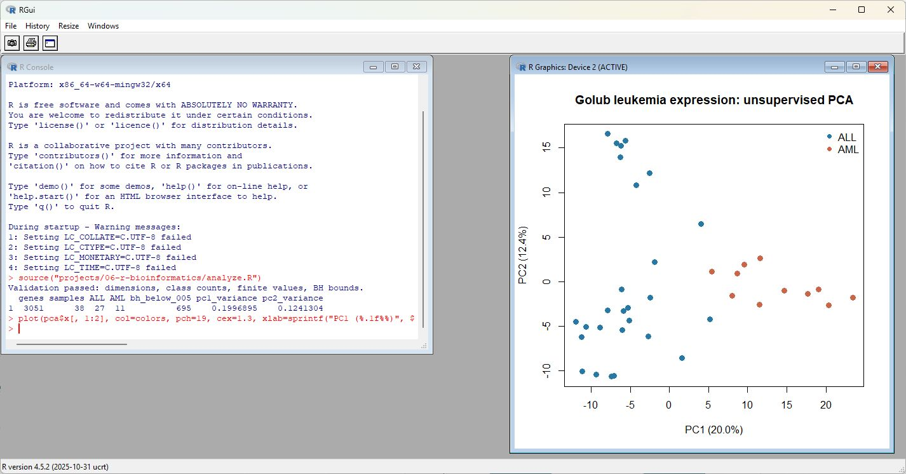
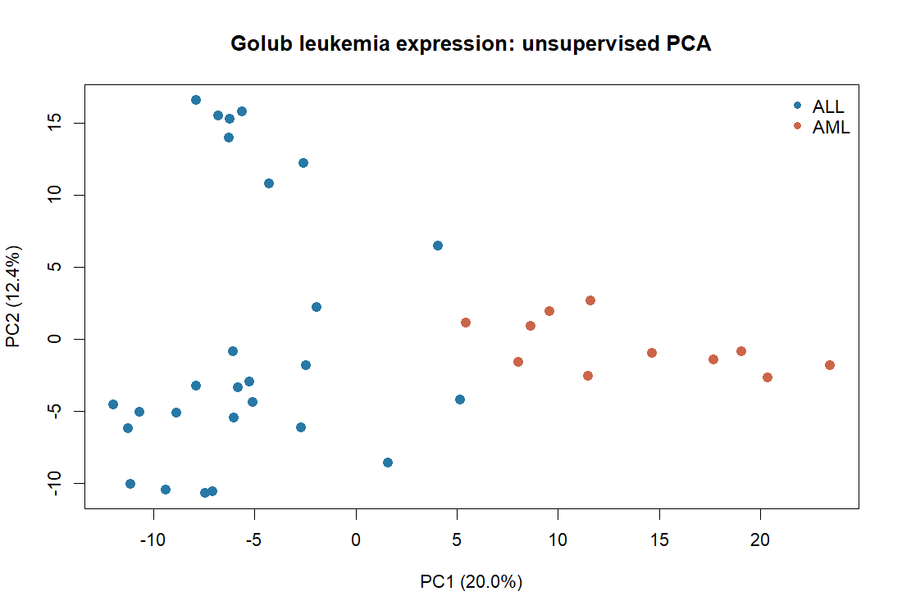
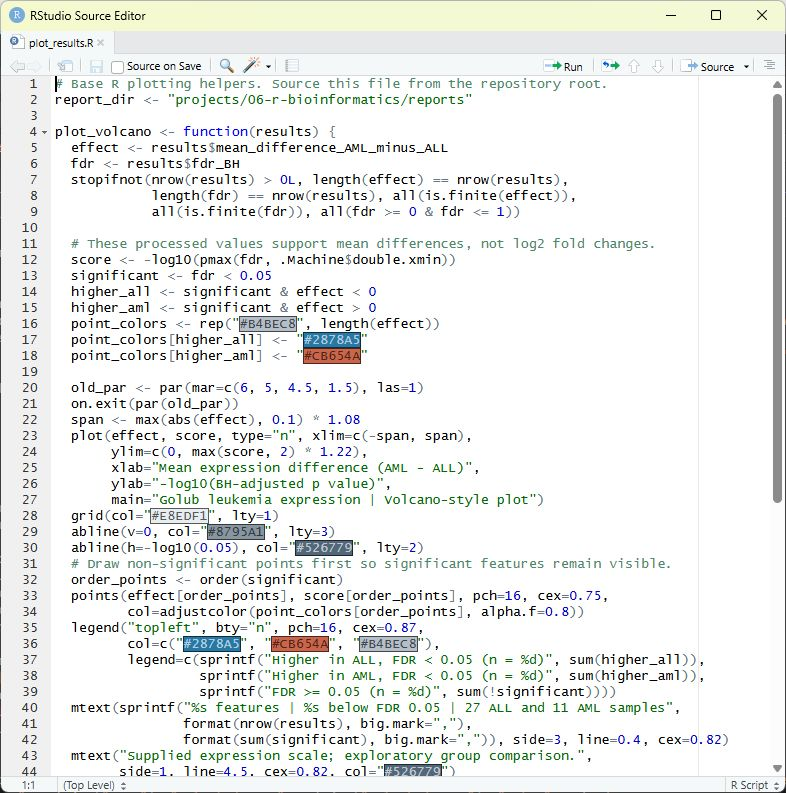
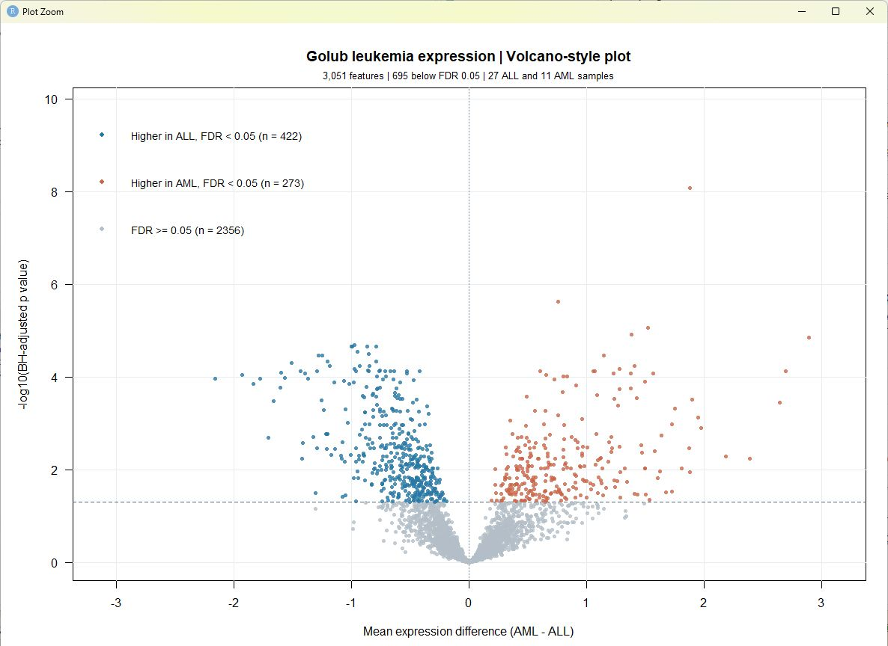
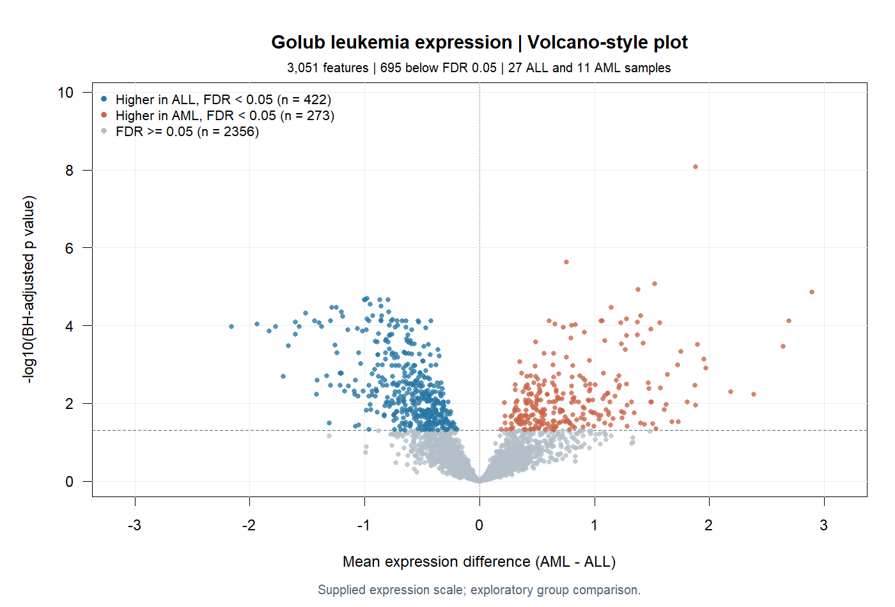

# Exploring leukemia expression data in R

[← All projects](../../README.md#projects) · [Source code](analyze.R) · [Results](reports/summary.csv)

I compared ALL and AML samples in the preprocessed Golub microarray dataset: **3,051 expression features across 38 tumors**. The separate feature tests found **695 BH-adjusted hits**. I also used PCA to look at sample variation without using the class labels to select features.

**Tools:** Base R · Welch tests · PCA

## The sample view

I selected the 500 most variable features, centered and scaled them, then ran PCA across samples. [The code](analyze.R#L32-L35) uses `prcomp`; group labels only supply the plot colors:

```r
selected <- order(apply(x,1,var),decreasing=TRUE)[seq_len(500)]
pca <- prcomp(t(x[selected,]),center=TRUE,scale.=TRUE)
variance <- pca$sdev^2/sum(pca$sdev^2)
colors <- ifelse(group=='ALL','#2878A5','#CB654A')
```



With the repository root as the working directory, run this in the R console:

```r
source("projects/06-r-bioinformatics/analyze.R")
```



The console prints the counts and variance shares saved in [summary.csv](reports/summary.csv). This plot uses the scores from that R session:

[](reports/pca.png)

PC1 explains **19.97%** and PC2 **12.41%** of variance among the selected scaled features, **32.38%** together. Nearby points have similar expression profiles in these two dimensions.



## Comparing individual features

I checked the matrix dimensions, finite values and class-label counts before running two-sided Welch tests for all **3,051 features**. Effects are **AML minus ALL**, with Benjamini–Hochberg correction across the full test family. **695 features have BH-adjusted p < 0.05** in this cohort.

The results include mean differences and nominal 95% Welch confidence intervals. These intervals are neither simultaneous nor FDR-adjusted. The supplied expression-scale differences **are not log₂ fold changes**. Gene descriptions and probe accessions retain the package annotation, including historical labels that may differ from modern gene identifiers.

### Volcano-style plot in R

The volcano-style view places the **mean expression difference (AML minus ALL)** on the horizontal axis and **−log₁₀(BH-adjusted p)** on the vertical axis. It uses the supplied expression scale, so the horizontal values must not be read as log₂ fold changes. The horizontal reference marks adjusted p = 0.05; the plot does not add an arbitrary fold-change cutoff.

The [R plotting functions](plot_results.R) redraw the saved statistics in an R session. From the repository root:

```r
source("projects/06-r-bioinformatics/plot_results.R")
show_pca()
show_volcano()
```



[](reports/volcano.png)



Points passing the BH-adjusted 0.05 threshold are distinguished by the direction of their mean difference. The 695 hits remain exploratory cohort results, as in the statistics above. Running [analyze.R](analyze.R) also saves this figure along with the PCA and feature tables.

The saved outputs include [all feature statistics](reports/gene_statistics.csv), [PCA scores](reports/pca_scores.csv), the [summary](reports/summary.csv) and [R session information](reports/sessionInfo.txt).

## Run from a terminal

From the repository root with R 4.5 or newer:

```bash
Rscript projects/06-r-bioinformatics/analyze.R
# Optional: supply an already downloaded multtest_2.68.0.tar.gz as the first argument.
```

The script extracts only the Golub data object from the pinned source package into a temporary directory. It does not install or execute the package's R code. The analysis uses base R and needs no extra packages.

## How far the results go

This is a small, preprocessed historical cohort with no independent replication, batch adjustment or clinical validation. Original preprocessing already filtered the features, so the test family is the supplied **3,051-feature subset**, not every gene in the original assay. Correlated features complicate inference, and BH behavior depends on its dependence assumptions. PCA separation and small adjusted p-values do not establish a causal mechanism or diagnostic utility.

I would next examine original assay metadata, update probe annotations, use a covariate-aware limma design and replicate the analysis in an independent cohort.

## Sources and attribution

- Golub et al. (1999), *Molecular classification of cancer: class discovery and class prediction by gene expression monitoring*, Science 286:531–537. [DOI](https://doi.org/10.1126/science.286.5439.531).
- Dudoit, Fridlyand and Speed (2002), *Comparison of discrimination methods for the classification of tumors using gene expression data*, JASA 97(457):77–87 (source preprocessing).
- [Bioconductor multtest 2.68.0](https://bioconductor.org/packages/release/bioc/html/multtest.html), [reference manual, Golub data section](https://bioconductor.org/packages/release/bioc/manuals/multtest/man/multtest.pdf), [package DOI](https://doi.org/10.18129/B9.bioc.multtest). Package license: LGPL. The package/data are not relicensed by the MIT license for this project's original code. Original raw expression matrices are not redistributed here.
- [Source archive SHA-256](provenance.json) records the downloaded Bioconductor mirror artifact.
