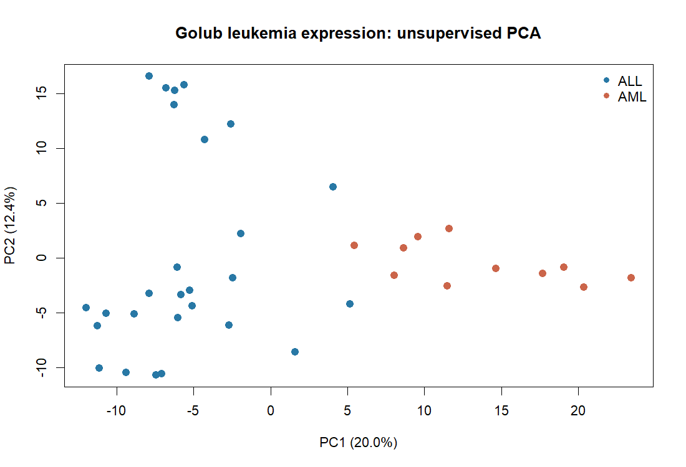
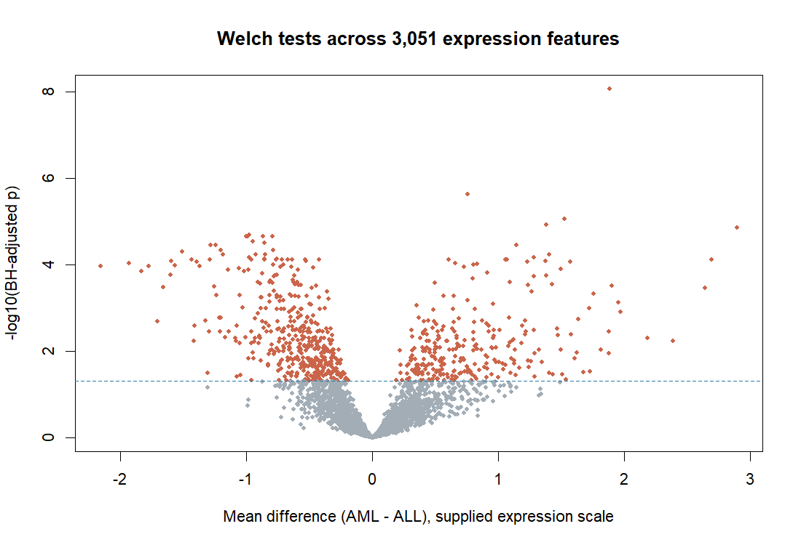

# 06 · Leukemia expression analysis in R

**Research question:** Which supplied expression features differ between ALL and AML in the historical Golub study, and what structure appears without using the class labels?

The project uses real preprocessed microarray data distributed in Bioconductor's `multtest` package: **3,051 expression features × 38 tumor samples** (27 ALL, 11 AML). It is an exploratory reanalysis, not a diagnostic model.

## Run

From the repository root with R 4.5 or newer:

```bash
Rscript projects/06-r-bioinformatics/analyze.R
# Optional: supply an already downloaded multtest_2.68.0.tar.gz as the first argument.
```

The script extracts only the Golub data object from the pinned source package into a temporary directory. It does not install or execute the package's R code. Analysis uses base R, with no extra package installation.

## Methods

1. Validate matrix dimensions, finite values, and class-label counts.
2. Run two-sided Welch tests per feature, with AML minus ALL as the effect direction.
3. Apply Benjamini–Hochberg correction over all 3,051 tests.
4. Report mean differences and nominal 95% Welch confidence intervals. These intervals are not simultaneous or FDR-adjusted.
5. Select the 500 highest-variance features without class labels, center/scale them, and perform PCA across samples.

The source is already preprocessed. Supplied expression-scale differences **must not be described as log₂ fold changes**. Gene descriptions and probe accessions preserve the package annotation, whose historical labels can differ from modern gene identifiers.

## Measured outputs

- **695** expression features have BH-adjusted p < 0.05 in this dataset.
- PC1 explains **19.97%** and PC2 **12.41%** of variance among the selected scaled features.
- [All feature statistics](reports/gene_statistics.csv), [PCA scores](reports/pca_scores.csv), [summary](reports/summary.csv), and [R session information](reports/sessionInfo.txt) are included.





## Interpretation and limitations

The discoveries concern associations in this small, preprocessed historical cohort. There is no independent replication, batch adjustment, or clinical validation. Features were filtered during the original published preprocessing, so the test family is the supplied 3,051-feature subset rather than all genes in the original assay. Correlated features complicate inference; BH behavior relies on its dependence assumptions. Neither PCA separation nor a small adjusted p-value proves a causal mechanism or diagnostic utility.

Future work: analyze original assay metadata, update probe annotations, use a covariate-aware limma design, and replicate in an independent cohort.

## Sources and attribution

- Golub et al. (1999), *Molecular classification of cancer: class discovery and class prediction by gene expression monitoring*, Science 286:531–537. [DOI](https://doi.org/10.1126/science.286.5439.531).
- Dudoit, Fridlyand and Speed (2002), *Comparison of discrimination methods for the classification of tumors using gene expression data*, JASA 97(457):77–87 (source preprocessing).
- [Bioconductor multtest 2.68.0](https://bioconductor.org/packages/release/bioc/html/multtest.html), [reference manual, Golub data section](https://bioconductor.org/packages/release/bioc/manuals/multtest/man/multtest.pdf), [package DOI](https://doi.org/10.18129/B9.bioc.multtest). Package license: LGPL. The package/data are not relicensed by the MIT license for this project's original code. Original raw expression matrices are not redistributed here.
- [Source archive SHA-256](provenance.json) records the downloaded Bioconductor mirror artifact.
