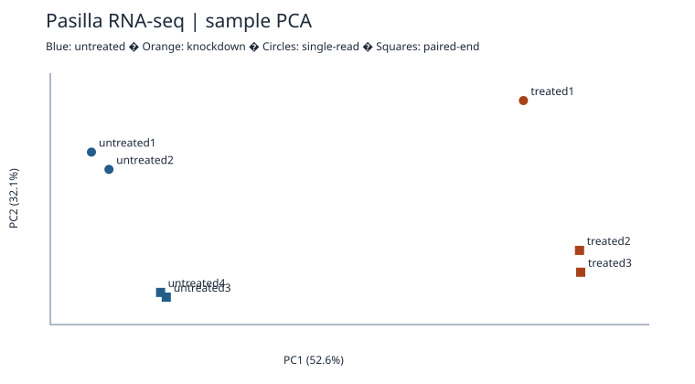
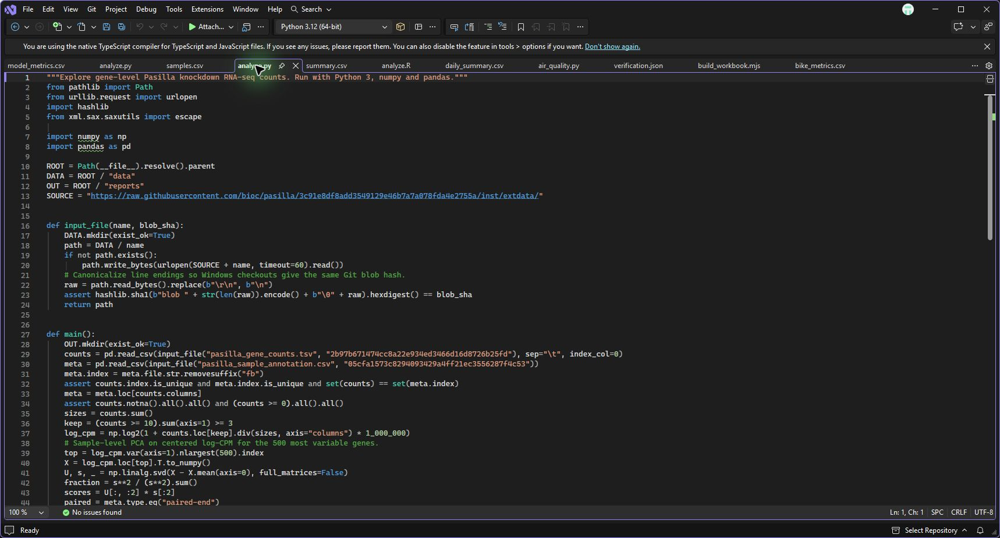
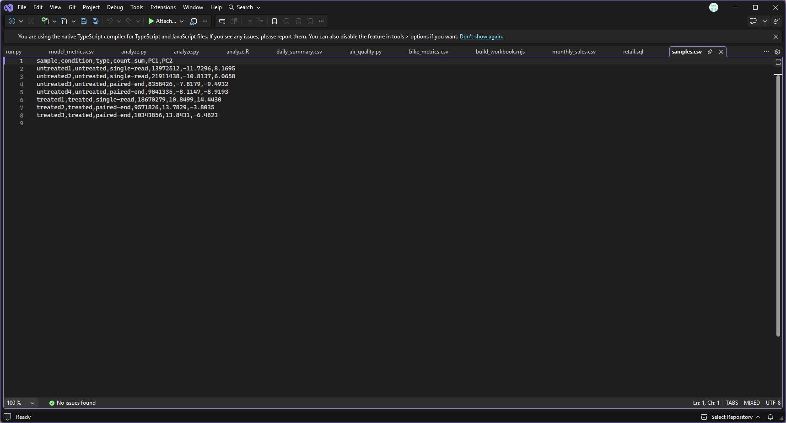
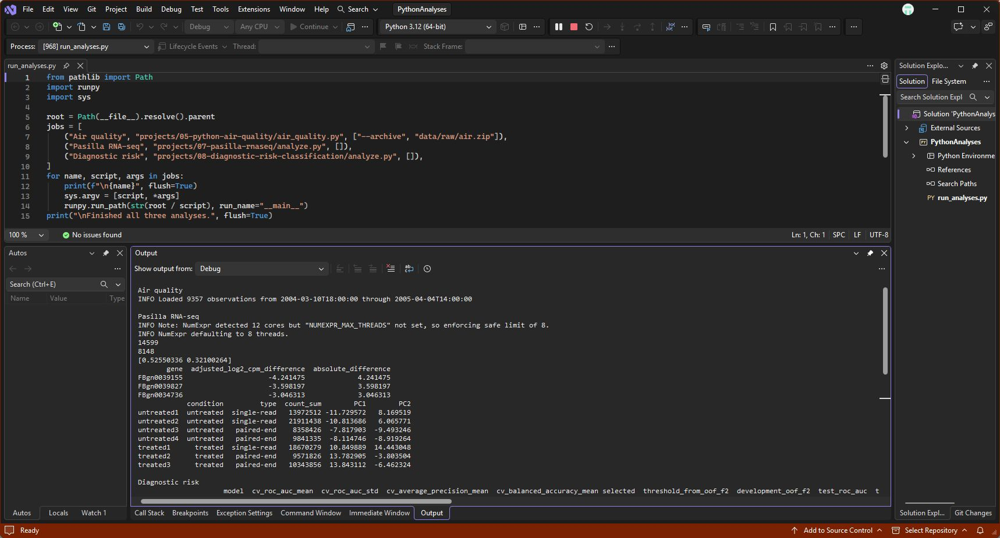
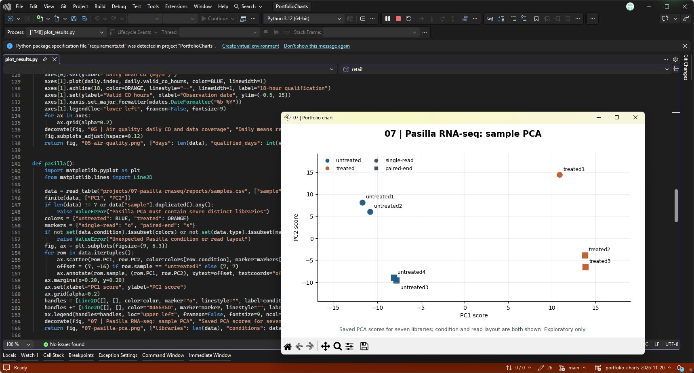

# Exploring Pasilla RNA-seq counts

[← All projects](../../README.md#projects) · [Source code](analyze.py) · [Results](reports/samples.csv)

**Tools:** Python, pandas and NumPy

I compared three Pasilla knockdown libraries with four controls to see how treatment and sequencing layout relate to sample differences. In the PCA, PC1 (52.6%) separates the treatment groups and PC2 (32.1%) separates single-read and paired-end libraries. With only seven libraries, I kept both annotations visible and included layout in the gene comparison.

## From counts to sample differences

The [Bioconductor pasilla counts and annotations](https://github.com/bioc/pasilla/tree/3c91e8df8add3549129e46b7a7a078fda4e2755a/inst/extdata) come from the Brooks et al. experiment. These are Drosophila gene counts that have already been aligned and summarized. Both the four untreated libraries and the three knockdown libraries include both read layouts.

I used pandas to match and reorder sample identifiers, inspect library sizes, and retain genes with at least ten counts in three or more libraries. This kept **8,148 of 14,599 genes**. I normalized by the original library totals and calculated `log2(1 + counts per million)`. CPM adjusts for library size; the log transformation compresses the range. Neither models biological variability.

For PCA, I used NumPy SVD on the centered values of the 500 most variable genes. [This part of the script](analyze.py#L37-L43) produces the sample scores:

```python
log_cpm = np.log2(1 + counts.loc[keep].div(sizes, axis="columns") * 1_000_000)
# Sample-level PCA on centered log-CPM for the 500 most variable genes.
top = log_cpm.var(axis=1).nlargest(500).index
X = log_cpm.loc[top].T.to_numpy()
U, s, _ = np.linalg.svd(X - X.mean(axis=0), full_matrices=False)
fraction = s**2 / (s**2).sum()
scores = U[:, :2] * s[:2]
```



The Python standard library handles downloads, Git blob checks and the labeled SVG. The analysis script generates that SVG directly, without Matplotlib, Seaborn or a differential-expression package. The separate saved-report view below uses Matplotlib to redraw the exported PCA coordinates.

## A descriptive gene comparison

I fitted a separate linear model for each retained gene. The intercept, paired-end indicator and treatment indicator let me estimate the knockdown-minus-control difference while accounting for a separate layout offset:

```python
design = np.column_stack([np.ones(len(meta)), paired, treated])
assert np.linalg.matrix_rank(design) == 3
beta = np.linalg.lstsq(design, log_cpm.T, rcond=None)[0][2]
```

The script checks sample alignment, that both conditions contain both layouts, and that the design has full column rank. These checks make the treatment coefficient estimable; they do not overcome the small sample or the limits of simple library-size normalization.

**FBgn0039155** had the largest absolute adjusted difference: **−4.2415**, or **−4.24** rounded, on the log2(1 + CPM) scale. Its normalized expression was lower in knockdown libraries after adjusting for layout. This ranks an observed effect size; it does not establish significance or causality. PCA separation is also a sample diagnostic, not a gene-level significance test.

For differential-expression inference, I would use a count model with dispersion estimates, layout in the design and multiple-testing correction, then check sensitivity to filtering and normalization. Gene totals cannot resolve exon-level splicing changes; that question needs different inputs.

[Sample scores and library totals](reports/samples.csv) · [Top 20 descriptive contrasts](reports/largest_contrasts.csv) · [Analysis code](analyze.py)

## Visual Studio run

The screenshots show the normalization and PCA code, [samples.csv](reports/samples.csv), and the library totals and PCA coordinates printed for all seven samples.







[](reports/pca.svg)

Run `python plot_results.py --project 07 --show` from the repository root to open this view. The [chart code](../../plot_results.py) retains both condition and sequencing layout, so the seven libraries can be compared without hiding either annotation. It reads the saved scores rather than recomputing PCA or testing differential expression.

## Run it

From the repository root, use Python 3.12. The script downloads two study files from a pinned commit, verifies their Git blob hashes, and regenerates the CSVs and SVG. Tested with NumPy 2.3.5 and pandas 3.0.1.

```sh
python -m pip install numpy==2.3.5 pandas==3.0.1
python projects/07-pasilla-rnaseq/analyze.py
```

**Source:** Brooks et al., *Conservation of an RNA regulatory map between Drosophila and mammals* (2011). [Bioconductor dataset and citation](https://bioconductor.org/packages/pasilla/). Input data retain their original terms.
