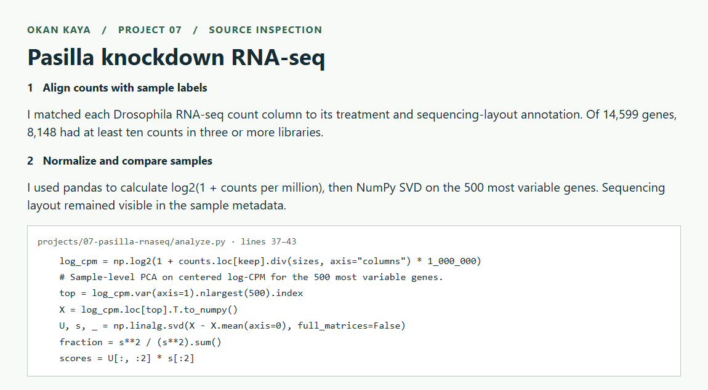
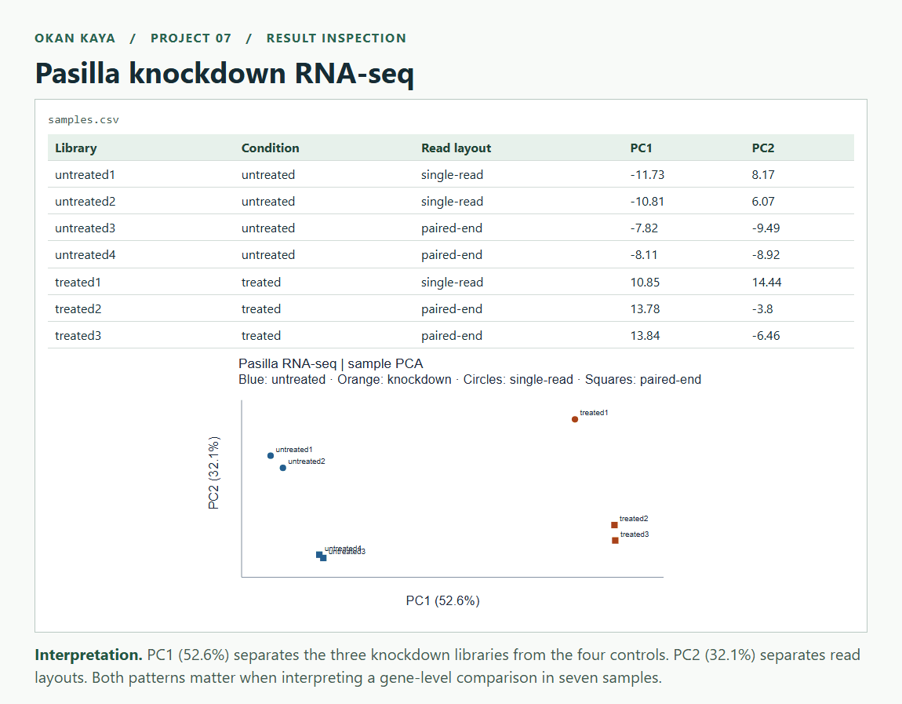
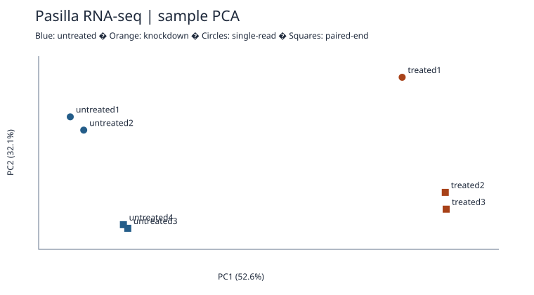

# Exploring Pasilla RNA-seq counts

[← All projects](../../README.md#projects) · [Source code](analyze.py) · [Results](reports/samples.csv)

**Tools** · Python · pandas · NumPy

This analysis compares three Pasilla knockdown libraries with four controls. It also checks how single-read and paired-end sequencing relate to the sample differences.

## Step-by-step walkthrough

1. **Align counts with sample labels.** I matched each Drosophila RNA-seq count column to its treatment and sequencing-layout annotation. Of 14,599 genes, 8,148 had at least ten counts in three or more libraries.
2. **Normalize and compare samples.** I used pandas to calculate log2(1 + counts per million), then NumPy SVD on the 500 most variable genes. Sequencing layout remained visible in the sample metadata. [Open the implementation](analyze.py#L37-L43).

```python
log_cpm = np.log2(1 + counts.loc[keep].div(sizes, axis="columns") * 1_000_000)
# Sample-level PCA on centered log-CPM for the 500 most variable genes.
top = log_cpm.var(axis=1).nlargest(500).index
X = log_cpm.loc[top].T.to_numpy()
U, s, _ = np.linalg.svd(X - X.mean(axis=0), full_matrices=False)
fraction = s**2 / (s**2).sum()
scores = U[:, :2] * s[:2]
```

<details>
<summary>Open the annotated code screenshot</summary>



</details>

3. **Inspect the output.** Open [samples.csv](reports/samples.csv) and the [analysis figure](reports/pca.svg). The screenshot puts the saved output beside a short explanation.
4. **Interpret the result.** PC1 (52.6%) separates the three knockdown libraries from the four controls. PC2 (32.1%) separates read layouts. Both patterns matter when interpreting a gene-level comparison in seven samples.



## Data and method

I used the [Bioconductor pasilla gene counts and sample annotations](https://github.com/bioc/pasilla/tree/3c91e8df8add3549129e46b7a7a078fda4e2755a/inst/extdata) from the Brooks et al. experiment. The inputs are gene-level counts, already aligned and summarized. There are four untreated libraries and three knockdown libraries. Both groups include single-read and paired-end libraries.

I used **pandas** to match sample identifiers, inspect library sizes, and retain 8,148 of 14,599 genes with at least 10 counts in at least three libraries. I divided counts by the original library totals and applied log2(1 + counts per million). With **NumPy**, I centered the 500 most variable genes across samples and computed a singular value decomposition for PCA. I then fitted a separate descriptive linear model per retained gene, estimating the knockdown-minus-control difference after accounting for read layout.




## What the gene comparison tells us

**FBgn0039155** had the largest absolute adjusted difference, **−4.24** on the log2(1 + CPM) scale. Its normalized expression was lower in knockdown libraries after accounting for layout. This is an exploratory ranking by effect size. The small experiment and simple library-size normalization limit the conclusion. A differential-expression significance analysis would require a count model with dispersion estimates and multiple-testing correction. Gene counts also cannot resolve exon-level splicing changes.

[Sample scores and library totals](reports/samples.csv) · [Top 20 descriptive contrasts](reports/largest_contrasts.csv) · [Analysis code](analyze.py)

## Reproduce

From the repository root, run the following with Python 3.12. The script downloads the two study files from a pinned commit, checks their Git blob hashes, then regenerates the CSVs and SVG. Tested with NumPy 2.3.5 and pandas 3.0.1.

```sh
python -m pip install numpy==2.3.5 pandas==3.0.1
python projects/07-pasilla-rnaseq/analyze.py
```

**Source:** Brooks et al., *Conservation of an RNA regulatory map between Drosophila and mammals* (2011). [Bioconductor dataset and citation](https://bioconductor.org/packages/pasilla/). Input data retain their original terms.
