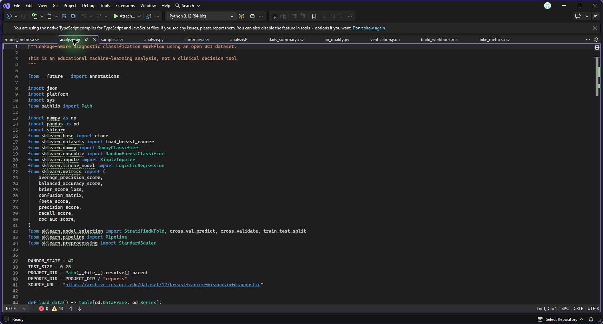
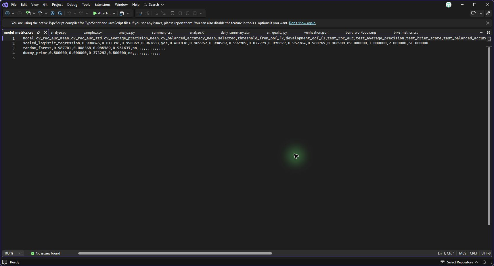
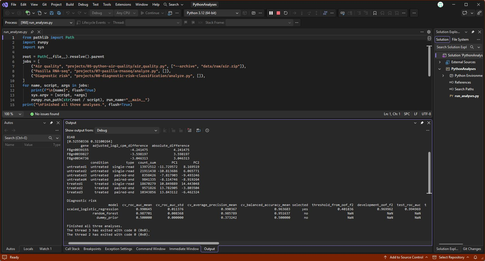

# Diagnostic risk classification

[← All projects](../../README.md#projects) · [Source code](analyze.py) · [Model comparison](reports/model_metrics.csv) · [Run record](reports/run_summary.json)

**Tools:** Python, pandas, NumPy and scikit-learn

I compared a class-prior baseline, scaled logistic regression and a random forest. Logistic regression had the best development cross-validation ROC AUC. With an F2 threshold chosen from development predictions, it missed **2 malignant cases** and flagged **1 benign case** on the 143-row holdout.

> This is an educational analysis of a small historical dataset. It is not a clinical tool and must not be used for diagnosis, screening or treatment decisions.

## How I kept the holdout separate

The Breast Cancer Wisconsin (Diagnostic) data come from the [UCI Machine Learning Repository](https://archive.ics.uci.edu/dataset/17/breast+cancer+wisconsin+diagnostic), loaded through `sklearn.datasets.load_breast_cancer`. There are **569 observations**, **30 numeric measurements**, **212 malignant** and **357 benign** cases. I recoded the scikit-learn target so `1` means malignant instead of `0`. No patient identifiers are present or added.

I first reserved a stratified **25% holdout (143 rows)**. On the remaining **426 rows**, I compared the three candidates using five shuffled stratified folds. Imputation and scaling stay inside each pipeline, so they are fitted on each fold's training rows.

I selected the model by mean cross-validated ROC AUC, then chose its threshold using only development out-of-fold probabilities. The threshold maximizes **F2**, which gives recall more weight than precision. I evaluated the selected pipeline on the holdout once. The script uses seed `42` and checks that development and holdout rows do not overlap.

## Scores and error counts

| Model | Development CV ROC AUC (mean ± SD) | Development CV average precision | Development CV balanced accuracy |
|---|---:|---:|---:|
| Class-prior baseline | 0.500 ± 0.000 | 0.373 | 0.500 |
| Scaled logistic regression | **0.991 ± 0.011** | **0.990** | **0.964** |
| Random forest | 0.988 ± 0.008 | 0.986 | 0.952 |

The selected logistic-regression pipeline used an out-of-fold threshold of **0.402**. Its untouched holdout results were:

| Measure | Result |
|---|---:|
| ROC AUC | 0.995 |
| Average precision | 0.993 |
| Balanced accuracy | 0.976 |
| Malignant recall | 0.962 |
| Malignant precision | 0.981 |
| F2 | 0.966 |

The confusion counts were **89 true negatives, 1 false positive, 2 false negatives and 51 true positives**. These describe one split, not a performance guarantee. ROC AUC measures ranking; the threshold determines the flags and errors.

## What these results leave open

This small historical dataset may not represent current patients, devices, populations or clinical workflows. Measurements and diagnoses omit decision-making context and cannot establish causality or treatment benefit.

Model and threshold selection use the same development set. The holdout provides a separate evaluation, but not external validation. These high scores apply to this dataset and split, not clinical performance. A real review system would need externally validated thresholds based on error costs, plus calibration and subgroup monitoring.

## Files and Visual Studio screenshots

| File | Contents |
|---|---|
| [model_metrics.csv](reports/model_metrics.csv) | Cross-validation results for all candidates and the selected model's single holdout evaluation |
| [holdout_predictions.csv](reports/holdout_predictions.csv) | Holdout row index, true class, malignant probability and threshold flag |
| [run_summary.json](reports/run_summary.json) | Source, split size, package versions, threshold and evaluation values |

The screenshots show the [pipeline code](analyze.py), saved comparison and debugger metrics.







## Run it

Tested with Python 3.12.14, NumPy 2.3.5, pandas 2.2.3 and scikit-learn 1.8.0. From the repository root or its Visual Studio terminal:

```sh
cd projects/08-diagnostic-risk-classification
python -m pip install -r requirements.txt
python -m unittest discover -s . -p 'test_*.py' -v
python analyze.py
```

The script writes all reported outputs. Floating-point values may differ slightly on another platform or library release.
