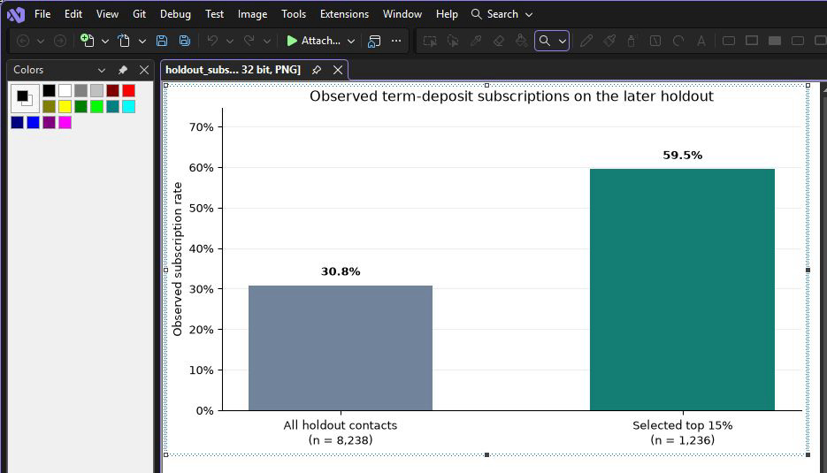

# Bank campaign propensity targeting

[← All projects](../../README.md#projects) · [Source code](analyze.py) · [Model comparison](reports/model_comparison.csv) · [Run record](reports/run_summary.json)

**Tools** · Python · pandas · scikit-learn · temporal validation

This project asks a campaign-planning question: if a team can contact only the highest-scored **15%** of a later contact list, how concentrated are the observed subscriptions? It uses a public historical bank-marketing dataset and keeps a later portion of the ordered data untouched until the final evaluation.

> **Scope:** educational analysis of historical, anonymized campaign records. It is not a production targeting system, a causal estimate, or a recommendation to contact any individual.

## Business question

1. Can pre-contact information rank likely subscriptions better than a class-prior baseline?
2. Under a fixed calling capacity of 15%, how many observed subscriptions fall into the selected segment?
3. Does performance remain meaningful on later rows rather than only on randomly mixed data?

## Data and leakage decision

The analysis uses the **bank-additional-full** table (41,188 contacts) from the [UCI Bank Marketing dataset](https://archive.ics.uci.edu/dataset/222/bankmarketing). The input archive is downloaded from the official UCI URL and checked against SHA-256 `e0bf5f5de5b846e2f18e9d90606637267d46dfa260e0f17bb12e605db5efbeb4` before it is read. The raw data are cached locally but not committed to this repository.

The original target is whether the client subscribed to a term deposit (`yes`/`no`). There are 4,640 subscriptions (11.3%) in the full table.

**Call duration is deliberately excluded.** The source documentation says it is known after a call; using it to decide whom to call beforehand would leak post-contact information. The original `campaign` field includes the current contact, so the script converts it to `prior_campaign_contacts = campaign - 1`. The `pdays = 999` sentinel becomes two features: a `previously_contacted` flag and `days_since_previous_contact = -1` when no prior contact is recorded.

## Validation design

The source file is ordered, so random shuffling would mix earlier and later campaign periods. Instead:

1. The first 80% (**32,950** rows) form development data; the last 20% (**8,238** rows) are held out as later records.
2. Within development data, five expanding `TimeSeriesSplit` folds train on earlier rows and validate on later rows.
3. A class-prior baseline, regularized logistic regression, and random forest all fit imputation, encoding, and scaling *inside* each fold.
4. The model with the highest mean cross-validated average precision is selected.
5. For the untouched holdout, the top 15% of scores are selected exactly. This fixed-capacity policy avoids silently changing the number of contacts when outcome prevalence shifts.

## Measured results

### Development folds

| Model | Mean CV average precision ± SD | Mean CV ROC AUC ± SD | Mean precision among top 15% | Mean lift among top 15% |
|---|---:|---:|---:|---:|
| Class-prior baseline | 0.071 ± 0.040 | 0.500 ± 0.000 | 0.079 | 0.993 |
| Logistic regression | **0.086 ± 0.066** | **0.538 ± 0.079** | **0.095** | **1.200** |
| Random forest | 0.083 ± 0.067 | 0.510 ± 0.057 | 0.090 | 1.136 |

Logistic regression was selected. The fold results are modest and variable, which is useful evidence rather than something to hide: the campaign context changes over time.

### Later untouched holdout

The later holdout subscription rate is **30.8%**, versus **6.4%** in development. That large shift means raw predicted probabilities need recalibration before any real use.

Under the fixed 15% capacity policy, the model selected **1,236 of 8,238** later contacts. Of these, **736** had an observed subscription:

| Holdout measure | Result |
|---|---:|
| Precision among selected contacts | **59.5%** |
| Recall of all observed subscriptions | **29.0%** |
| Lift over the 30.8% holdout base rate | **1.93×** |
| ROC AUC | **0.747** |
| Average precision | **0.533** |
| Brier score | **0.191** |

For comparison, a random 15% of this holdout would contain about 381 subscriptions at the observed base rate; this ranking selected 736. That is a concentration result on one historical split, not a causal estimate of subscriptions created by outreach or a guarantee for another campaign.


## Outputs

| File | Contents |
|---|---|
| [fold_metrics.csv](reports/fold_metrics.csv) | Each earlier-to-later validation fold and model |
| [model_comparison.csv](reports/model_comparison.csv) | Candidate averages and one final later-holdout result for the selected model |
| [holdout_targeted_contacts.csv](reports/holdout_targeted_contacts.csv) | The 1,236 top-scored holdout rows, observed label, and model score; no personal identifiers |
| [run_summary.json](reports/run_summary.json) | Source archive hash, split details, package versions, and measured metrics |
| [holdout_subscription_rates.png](reports/holdout_subscription_rates.png) | Observed subscription rates for the full holdout and the selected contacts |

## Reproduce

Tested with Python 3.12.14, NumPy 2.3.5, pandas 2.2.3, and scikit-learn 1.8.0.

```sh
cd projects/09-bank-campaign-propensity
python -m pip install -r requirements.txt
python -m unittest discover -s . -p 'test_*.py' -v
python analyze.py
```

The first run downloads and verifies the public UCI archive. Later runs reuse the verified local cache. The script writes all files in `reports/` and checks the expected table schema, target encoding, capacity selection, and leakage exclusion.

To recreate the chart from the saved run summary, install Matplotlib and run [plot_results.py](plot_results.py) from the project folder:

```sh
python -m pip install matplotlib
python plot_results.py
```

## Code and results in Visual Studio

1. **Inspect the model pipeline.** Open [analyze.py](analyze.py) to see how the script trains on earlier rows, validates on later rows, and chooses the best candidate by development average precision.

   

2. **Run the analysis.** Use the reproduction commands above. The Visual Studio debugger run below uses Python 3.12.8 on Windows with the pinned analysis dependencies. It reports four passing tests, the selected model, and holdout metrics that match the published [run summary](reports/run_summary.json).

   

3. **Compare the results visually.** The chart displays the observed subscription rate among all later contacts and among the 1,236 contacts selected by the fixed-capacity policy. The full candidate comparison is available in [model_comparison.csv](reports/model_comparison.csv).

   

## Limitations and responsible use

- This is a historic, anonymized dataset with an ordered campaign context. Its 30.8% later holdout rate differs sharply from the 6.4% development rate, so the results cannot be transferred without monitoring and recalibration.
- Demographic and financial-context variables can carry inequities. This project does not assess fairness, legal basis, consent, or the impact of contacting people.
- The data contain observed subscriptions, not the counterfactual outcome of contacting versus not contacting someone. The model estimates association, not campaign uplift or causal effect.
- A 15% capacity rule is illustrative. A real policy would need a validated cost model, privacy review, opt-out handling, external validation, and continuous drift checks.
- The top-contact export contains only source-row indices and model outputs. It is included for reproducibility, not for operational use.

## Citation

Moro, S., Rita, P., & Cortez, P. (2014). *Bank Marketing* [Dataset]. UCI Machine Learning Repository. [https://doi.org/10.24432/C5K306](https://doi.org/10.24432/C5K306). The associated study is *A Data-Driven Approach to Predict the Success of Bank Telemarketing*, *Decision Support Systems*, 62, 22–31.
