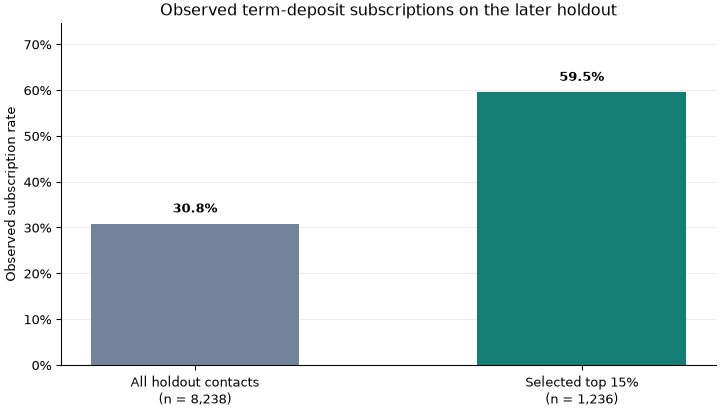
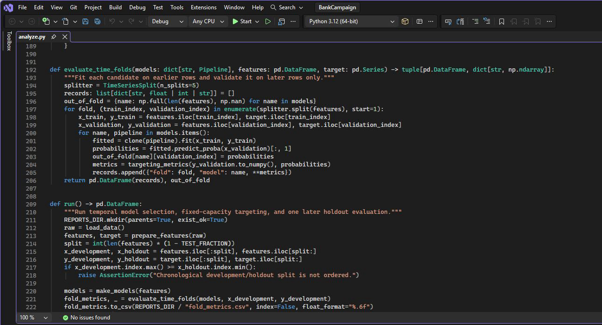
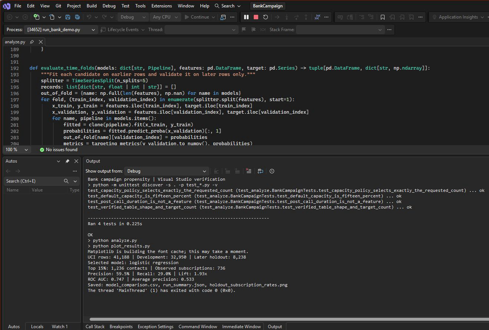

# Bank campaign propensity targeting

[← All projects](../../README.md#projects) · [Source code](analyze.py) · [Model comparison](reports/model_comparison.csv) · [Run record](reports/run_summary.json)

**Tools:** Python, pandas, scikit-learn and temporal validation

How many observed subscriptions fall into the highest-scored **15%** of a later contact list? I ranked historical bank-marketing records using pre-contact information. The selected logistic-regression model placed **736 subscriptions among 1,236 selected contacts**: a **59.5%** rate, compared with **30.8%** across the later holdout.

> This is an educational analysis of historical, anonymized records. It is not a production targeting system, a causal estimate or a recommendation to contact anyone.

## What went into the model

I used **bank-additional-full**, with **41,188 contacts** and **4,640 subscriptions (11.3%)**, from the [UCI Bank Marketing dataset](https://archive.ics.uci.edu/dataset/222/bankmarketing). The target is term-deposit subscription (`yes`/`no`). The script downloads the official UCI archive and verifies SHA-256 `e0bf5f5de5b846e2f18e9d90606637267d46dfa260e0f17bb12e605db5efbeb4`. Raw data are cached locally and are not committed.

I excluded **call duration** because it is known after the call and would leak information into a pre-contact decision. I also converted `campaign`, which includes the current contact, to `prior_campaign_contacts = campaign - 1`. For `pdays = 999`, the script creates a `previously_contacted` flag and sets `days_since_previous_contact = -1` when no prior contact is recorded.

## Testing on later records

The source file is ordered. I kept the first **80% (32,950 rows)** for development and the last **20% (8,238 rows)** for the final holdout, so earlier and later campaign periods stay separate.

Within development, five expanding `TimeSeriesSplit` folds train on earlier rows and validate on later rows. I compared a class-prior baseline, regularized logistic regression and a random forest, with imputation, encoding and scaling fitted inside each fold. The selection rule was highest mean cross-validated average precision.

| Model | Mean CV average precision ± SD | Mean CV ROC AUC ± SD | Mean precision among top 15% | Mean lift among top 15% |
|---|---:|---:|---:|---:|
| Class-prior baseline | 0.071 ± 0.040 | 0.500 ± 0.000 | 0.079 | 0.993 |
| Logistic regression | **0.086 ± 0.066** | **0.538 ± 0.079** | **0.095** | **1.200** |
| Random forest | 0.083 ± 0.067 | 0.510 ± 0.057 | 0.090 | 1.136 |

Logistic regression was selected. Its modest, variable fold results reflect a changing campaign context.

For the untouched holdout, I selected the top **15%** of scores: **1,236 of 8,238 contacts**. This keeps contact capacity fixed when subscription rates change. The rate rose from **6.4%** in development to **30.8%** in the holdout, so raw probabilities would need recalibration before real use.

| Holdout measure | Result |
|---|---:|
| Precision among selected contacts | **59.5%** |
| Recall of all observed subscriptions | **29.0%** |
| Lift over the 30.8% holdout base rate | **1.93×** |
| ROC AUC | **0.747** |
| Average precision | **0.533** |
| Brier score | **0.191** |

A random 15% of this holdout would contain about **381** subscriptions at its observed base rate; the ranking selected **736**. This measures concentration on one historical split. It does not estimate subscriptions caused by outreach or guarantee results in another campaign.



## Limits of this comparison

The records contain observed subscriptions, not counterfactual outcomes of contacting versus not contacting someone. The model measures association, not campaign uplift. Transferring the results requires monitoring and recalibration given the shift between development and holdout.

Demographic and financial variables can carry inequities; I have not assessed fairness, legal basis, consent or contact impacts. The illustrative 15% rule would need a validated cost model, privacy review, opt-out handling, external validation and continuous drift checks for real use. The export contains only source-row indices, observed labels and model outputs, with no personal identifiers. It is for reproducibility, not operational use.

## Saved outputs

| File | Contents |
|---|---|
| [fold_metrics.csv](reports/fold_metrics.csv) | Results for every earlier-to-later fold and model |
| [model_comparison.csv](reports/model_comparison.csv) | Candidate averages and the selected model's final holdout result |
| [holdout_targeted_contacts.csv](reports/holdout_targeted_contacts.csv) | The 1,236 selected holdout rows, observed labels and model scores |
| [run_summary.json](reports/run_summary.json) | Archive hash, split details, package versions and measured metrics |
| [holdout_subscription_rates.png](reports/holdout_subscription_rates.png) | Rates for the full holdout and selected contacts |

## Run and inspect it

Tested with Python 3.12.14, NumPy 2.3.5, pandas 2.2.3 and scikit-learn 1.8.0. From the repository root:

```sh
cd projects/09-bank-campaign-propensity
python -m pip install -r requirements.txt
python -m unittest discover -s . -p 'test_*.py' -v
python analyze.py
```

The first run downloads and verifies the archive; later runs reuse the verified cache. The script writes `reports/` and checks the table schema, target encoding, capacity selection and leakage exclusion.

Recreate the chart from the saved summary using [plot_results.py](plot_results.py) and Matplotlib, from the project folder:

```sh
python -m pip install matplotlib
python plot_results.py
```

The Visual Studio screenshots show [analyze.py](analyze.py), debugger output and the chart. This Windows run used Python 3.12.8 with pinned analysis dependencies: four tests passed, and the selected model and holdout metrics matched the [run summary](reports/run_summary.json).






**Citation:** Moro, S., Rita, P., & Cortez, P. (2014). *Bank Marketing* [Dataset]. UCI Machine Learning Repository. [https://doi.org/10.24432/C5K306](https://doi.org/10.24432/C5K306). Associated study: *A Data-Driven Approach to Predict the Success of Bank Telemarketing*, *Decision Support Systems*, 62, 22–31.
